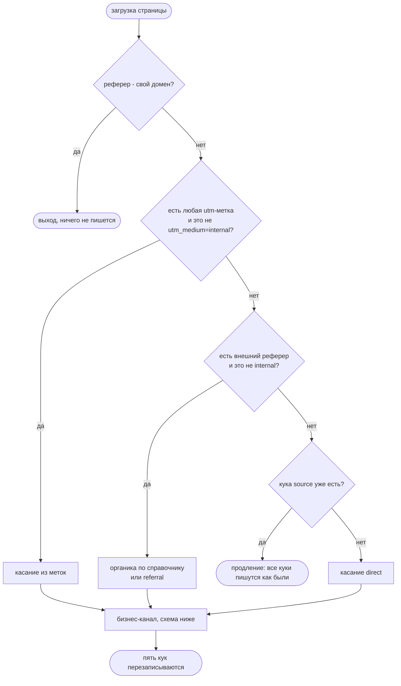
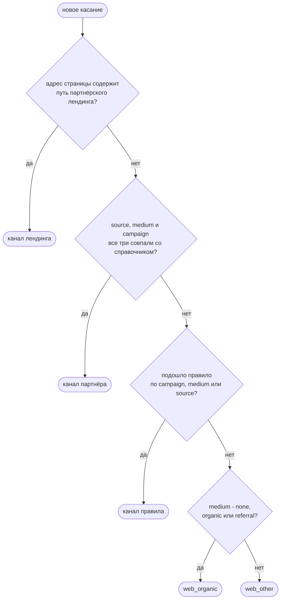

# attribution

Тег атрибуции для сайта с поддоменами. Определяет, откуда пришёл посетитель, и помнит
источник его последнего значимого захода в пяти куках на весь домен. Один файл
на чистом JavaScript, без зависимостей, ставится через тег-менеджер.

## Задача

Маркетингу нужно было понимать, откуда пришёл клиент, который в итоге оформил заказ.
Между первым переходом и покупкой может пройти несколько месяцев, а сам клиент за это
время гуляет по разным поддоменам сайта: каталог, личный кабинет, оплата. Источник
при этом должен оставаться тем, что привёл человека, а не последним кликом по
собственному меню.

Отчёты к этому моменту уже были построены на пяти куках старого скрипта. Ломать их
никто не хотел, поэтому новый тег пишет те же куки в том же формате, но по более
строгим правилам. Требования собрались такие:

- рекламная метка главнее реферера, иначе клик по объявлению из поиска запишется
  органикой;
- переходы внутри своего сайта источник не трогают;
- прямой заход не затирает уже известный источник, а только продлевает его;
- кроме сырых меток, нужен готовый бизнес-канал: та строка отчёта, к которой
  относится визит;
- код целиком помещается в поле тег-менеджера и проходит его проверку синтаксиса.

## Решение

Тег срабатывает на загрузке страницы и делает одно из трёх: ничего не пишет,
записывает новое касание или продлевает уже стоящие куки. Новое касание ложится
в пять кук сразу:

| Поле | Кука |
|---|---|
| source | `original_utm_source_v2` |
| medium | `original_utm_medium_v2` |
| campaign | `original_utm_campaign_v2` |
| term | `original_utm_term_v2` |
| бизнес-канал | `original_utm_channel` |

Куки пишутся вместе. Новое касание перезаписывает все пять, продление продлевает все,
что есть. Четыре поля берутся из меток и реферера, а бизнес-канал тег считает сам
по справочнику партнёров и правилам из `CONFIG`.

### Как работает

Схемы читаются сверху вниз: скруглённый блок это вход или выход, прямоугольник это
шаг, ромб это развилка. Проверки идут по порядку, решает первая сработавшая.



| # | Условие | source | medium | campaign | term |
|---|---|---|---|---|---|
| 1 | реферер - свой домен или его поддомен | ничего не пишется | | | |
| 2 | есть любая из `utm_source`, `utm_medium`, `utm_campaign`, `utm_term` (кроме `utm_medium=internal`) | `utm_source` или `(not_set)` | `utm_medium` или `(not_set)` | `utm_campaign` или `(not_set)` | `utm_term` или `(not_set)` |
| 3 | есть реферер, домен в `ORGANIC_HOSTS` | общее имя (`yandex`) | `organic` | `(not_set)` | `(not_set)` |
| 4 | есть реферер, домена в справочнике нет | домен без поддоменов (`vk.com`) | `referral` | `(not_set)` | `(not_set)` |
| 5 | ни меток, ни реферера, кука `original_utm_source_v2` есть | как в куках | как в куках | как в куках | как в куках |
| 6 | ни меток, ни реферера, куки нет | `(direct)` | `(none)` | `(not_set)` | `(not_set)` |

Несколько мест, которые видны только в коде и тестах.

- **Метки главнее реферера.** У рекламы реферер почти всегда поисковик или площадка,
  и по нему клик записался бы органикой. Меткой считается любая из четырёх: даже одна
  `utm_campaign=x` даёт касание, где source и medium `(not_set)`. Пустая метка
  (`utm_source=`) равна её отсутствию.
- **`utm_medium=internal`.** Это внутренняя ссылка самого сайта, а реферер у неё часто
  теряется: новая вкладка, `noreferrer`, скопированная ссылка. Поэтому такой заход
  идёт веткой прямого. Слово должно совпасть целиком, регистр не важен:
  `internal_promo` уже обычная метка.
- **Домен реферера** приводится к нижнему регистру, поддомены отбрасываются:
  `images.yandex.ru` становится `yandex.ru`. Для зон из двух частей остаются три
  метки, `yandex.com.tr`, а не `com.tr`.
- **Органика** пишется общим именем, а не доменом. Иначе отчёт раздробился бы
  на `yandex.ru`, `yandex.kz` и `ya.ru`.
- **Справочник проверяется через `hasOwnProperty`.** Обычное `ORGANIC_HOSTS[ref]`
  нашло бы реферер `constructor` в прототипе объекта, и он стал бы органикой.

### Бизнес-канал

Считается только для нового касания. При продлении канал остаётся как был.



Почему партнёр сверяется по трём меткам сразу? Под тем же `utm_source` может прийти
чужая кампания, и одного source мало. Метки без `utm_medium` органикой не считаются:
если не сработал ни лендинг, ни справочник, ни правило, канал будет `web_other`.

## Куки

```
<имя>=<значение>; domain=.example.com; path=/; expires=<сейчас + 720 дней>; SameSite=Lax; Secure
```

Пример после перехода по `https://example.com/catalog?utm_source=yandex&utm_medium=cpc&utm_campaign=autumn&utm_term=tariff`:

| Кука | Значение |
|---|---|
| `original_utm_source_v2` | `yandex` |
| `original_utm_medium_v2` | `cpc` |
| `original_utm_campaign_v2` | `autumn` |
| `original_utm_term_v2` | `tariff` |
| `original_utm_channel` | `web_other` |

- **Значения пишутся как есть**, без %-кодирования, кириллица остаётся кириллицей.
  На этот формат рассчитаны существующие отчёты.
- **Предел длины.** Новое значение режется до 1000 байт в UTF-8 по целым символам,
  это около 500 русских букв. Без предела одна длинная ссылка раздула бы куки на всех
  поддоменах, и сервер начал бы отвечать 400 на слишком большой заголовок.
- **`;` и управляющие символы вырезаются**, они рвут строку куки. Если после этого
  значение пустое, пишется `(not_set)`: пустая кука считалась бы отсутствующей, и
  следующий прямой заход затёр бы источник на direct.
- **`SameSite=Lax; Secure`.** Кука уходит при обычном переходе по ссылке, но не в чужих
  фоновых запросах, и только по HTTPS.

## Продление

Прямой заход, когда кука `original_utm_source_v2` уже есть, источник не меняет.
Каждая стоящая кука пишется обратно байт в байт, срок отсчитывается заново,
недостающие не создаются. Срок 720 дней от последней записи, но реальный зависит
от браузера: Chromium обрезает его до 400 дней, Safari держит куки из JS 7 дней.

## Установка в тег-менеджер

В тег вставляется собранный `attr.min.js`, а не `attr.js`. Пример для Яндекс Тег
Менеджера, в других менеджерах шаги те же.

1. Собрать `attr.min.js` (раздел "Сборка"). Первая строка файла - блочный комментарий
   `/* sha256 ... */` с хешем исходника. Блочный, а не `//`: если поле тега склеит
   строки, код не превратится в комментарий.
2. Новый тег типа "Пользовательский HTML".
3. В поле кода `<script>`, всё содержимое `attr.min.js`, `</script>`.
4. Триггер - загрузка страницы на домене и поддоменах. На смене маршрута в SPA тег
   не вызывается.
5. Если на сайте стоял прежний тег с теми же куками, отключить его в той же публикации,
   иначе два тега будут перезаписывать друг друга.

## Проверка на сайте

Открыть страницу сайта с метками, например `?utm_source=test&utm_medium=cpc&utm_campaign=check`,
и выполнить в консоли браузера:

```js
['original_utm_source_v2', 'original_utm_medium_v2', 'original_utm_campaign_v2', 'original_utm_term_v2', 'original_utm_channel'].forEach(function (n) {
  var p = document.cookie.split('; ').filter(function (c) { return c.indexOf(n + '=') === 0; })[0];
  console.log(n + ' = ' + (p === undefined ? '(нет)' : p.slice(n.length + 1)));
});
```

Ожидается `test`, `cpc`, `check`, `(not_set)`, `web_other`, и на любом поддомене то же
самое. Проверять нужно на самом сайте и по HTTPS. С `localhost` браузер молча отклонит
куку с чужим `domain`, а по HTTP не примет её из-за `Secure`.

## Сборка

```bash
node build.js
```

Собирает `attr.min.js` через terser, версия зафиксирована в `build.js`. Нужны Node
и доступ к npm. Тест сверяет хеш из первой строки с исходником, так что правка
`attr.js` без пересборки роняет тесты.

## Тесты

Нужен только Node. Из папки проекта:

```bash
node --test                                  # 40 тестов, attr.js и attr.min.js
npx --yes acorn --ecma2015 --silent attr.js  # синтаксис ES2015, код выхода 0
```

`node --test` без аргументов сам находит `tests/*.test.js`. С аргументом `tests/`
Node 26 падает: папку он не разворачивает.

Тесты запускают тег целиком, в том виде, в каком он уходит в тег-менеджер, внутри
песочницы `vm`. Там подменены `location`, `document` и `Date`. Тест задаёт адрес,
реферер, куки и время, запускает тег и разбирает строки, которые тот записал
в `document.cookie`. Внутренние функции наружу не выставлены, проверяется только
поведение, и одни и те же проверки идут по исходнику и по сборке.

## Настройки

Всё в объекте `CONFIG` в начале `attr.js`. Значения в репозитории - пример: домен,
партнёры и правила каналов под конкретный сайт заполняются свои.

| Параметр | В примере | Смысл |
|---|---|---|
| cookieDomain | `.example.com` | домен кук, с точкой - для поддоменов |
| windowDays | 720 | срок кук в днях от последней записи |
| NOT_SET | `(not_set)` | заглушка пустого поля |
| MAX_VALUE_BYTES | 1000 | предел нового значения в байтах UTF-8 |
| OWN_HOSTS | `example.com` + PAYMENT_HOSTS | свои домены, поддомены совпадают сами |
| PAYMENT_HOSTS | пусто | платёжные, 3DS и SSO-домены, домен второго уровня |
| MULTI_LABEL_ZONES | `com.tr`, `co.uk` и ещё четыре | зоны, где домен занимает три метки |
| ORGANIC_HOSTS | yandex, google, mail, rambler, bing, duckduckgo | органика: домен -> имя источника |
| INTERNAL_MEDIUM | `internal` | `utm_medium` внутренних ссылок |
| PARTNER_PATHS | `/partner-landing` -> `marketplace` | канал по адресу страницы |
| PARTNER_CHANNELS | пять партнёров | точное соответствие source + medium + campaign |
| REGEX_CHANNELS | восемь правил | канал по campaign, medium или source |
| BUSINESS_ORGANIC, BUSINESS_DEFAULT | `web_organic`, `web_other` | канал органики и канал по умолчанию |

## Ограничения

- **Click id без меток не разбирается.** Переход из рекламы с `yclid`, но без UTM,
  придёт с реферером поисковика и запишется органикой.
- **Веб-почта считается органикой.** `mail.yandex.ru` сворачивается в домен
  поисковика, и письмо уже не отличить от поиска.
- **Пока `PAYMENT_HOSTS` пуст, возврат после оплаты становится referral** и затирает
  настоящий источник. Домены банков и платёжных шлюзов можно выгрузить из аналитики:
  рефереры визитов со страницей успешной оплаты.
- **Реферер часто обрезан или пуст.** Внешний переход без реферера превращается
  в прямой заход.
- **Метки после `#` не видны**, хеш-маршруты не разбираются, SPA-переходы тег
  не обрабатывает.
- **Нужны `URL` и `URLSearchParams`**, IE11 не поддерживается.

## Устройство

```
attr.js                 тег целиком: настройки, чтение и запись кук, классификация
attr.min.js             сборка для тег-менеджера, первая строка - SHA-256 attr.js
build.js                сборка одной командой
tests/attr.test.js      поведение тега в песочнице vm
tests/partners.test.js  бизнес-канал: лендинг, справочник, правила, органика
```
