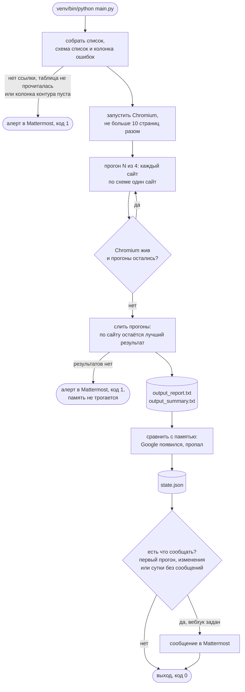
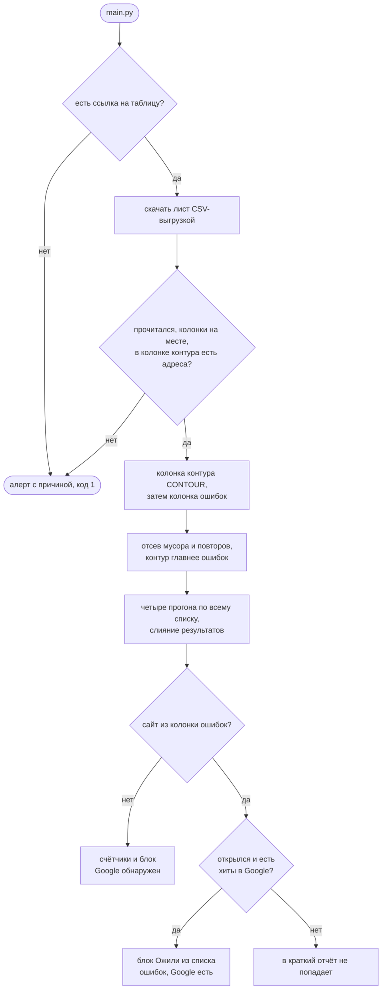
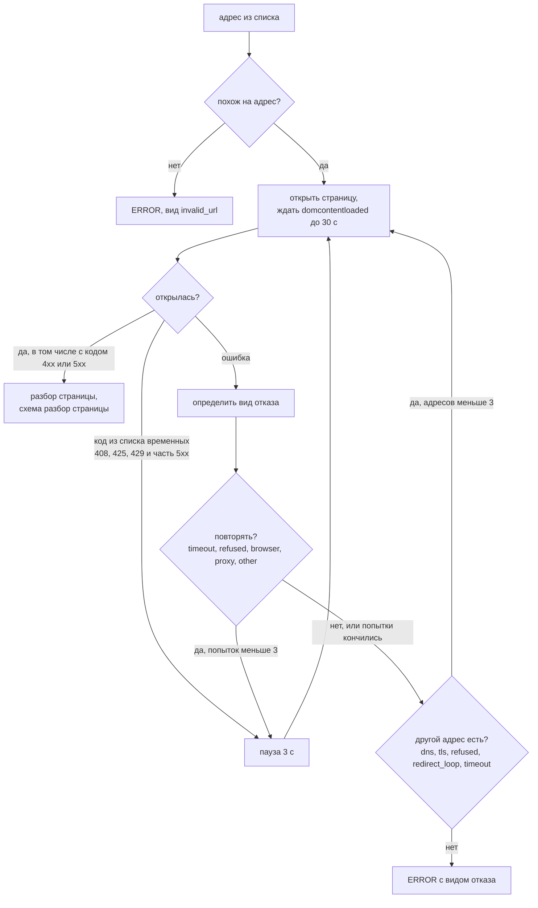
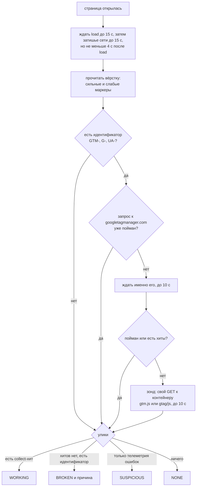
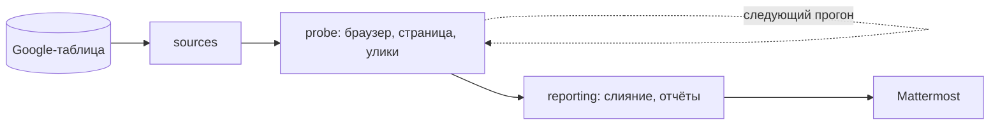

# google_page_checker

Берёт список сайтов из Google-таблицы, открывает каждый в настоящем браузере без окна и отвечает
на вопрос: стоит ли там Google Analytics и отправляет ли он данные. На выходе два текстовых
отчёта, а в Mattermost сообщение приходит, только когда у сайта появились или пропали
запросы в Google.

Документ для тех, кто будет запускать и поддерживать чекер. Порядок разделов: зачем он,
что на входе и выходе, как принимает решение, как устроен прогон (схемы), архитектура,
отчёты, как реагировать на типовые ситуации, установка, запуск, тесты, настройки,
что поддерживает, словарь.

## 1. Зачем

У компании несколько сотен сайтов, и никто не мог сказать, на скольких из них аналитика
реально собирает данные. Руками не проверить, а поиск строки `GTM-` в коде страницы даёт
неверный ответ. Три случая, где такой поиск ошибается:

- контейнер прописан в вёрстке, но удалён в интерфейсе GTM. Запрос за ним уходит
  и возвращает 404, данные никуда не идут;
- тег отключён конфигом платформы. Разметка на месте, запроса нет вообще;
- на странице стоит чужой скрипт (баннер согласия, чат, счётчик), который вызывает `gtag`
  без своего идентификатора. Своей аналитики у сайта нет.

Во всех трёх случаях поиск подстроки скажет, что аналитика есть. Поэтому чекер не ищет
строки, а открывает страницу в Chromium, слушает её сетевые запросы и смотрит, уходят ли
хиты на серверы Google. Значительная часть счётчиков подгружается скриптами уже после
загрузки страницы, без браузера их не увидеть.

## 2. Вход и выход

| Что | Где | Формат |
|---|---|---|
| Список сайтов | Google-таблица по ссылке из `secrets/sheet_url.txt` | один лист, колонки "ошибки", "внутренний", "внешний"; берётся колонка контура `CONTOUR` и колонка ошибок. Других источников нет, образец ссылки в `secrets/sheet_url.example.txt` |
| Краткий отчёт | `data/output_summary.txt` | сколько сайтов открылось, у скольких обнаружен Google, список таких сайтов |
| Расширенный отчёт | `data/output_report.txt` | по каждому сайту: статус, маркеры, запросы, что делать |
| Лог | `logs/app.log` | дозапись, каждый запуск добавляет строки |
| Память | `data/state.json` | у каких сайтов есть запросы в Google; по ней решается, о чём сообщать |
| Сообщение | Mattermost | только смена состояния: Google у сайта появился или пропал; раздел 6 |

Адреса без схемы получают `https://`. Повторы схлопываются: `https://a.ru` и `A.RU` это один
сайт, а `www.a.ru` и `a.ru` разные. Строки, не похожие на адрес ("нет", "уточняется"),
отсеиваются ещё до браузера, в лог пишется только их число. Раньше они доходили до отчёта
ошибкой `invalid_url` и раздували счётчик недоступных сайтов.

### Google-таблица

Тот же список, что у domain_checker, и та же таблица: один лист, заголовки в первой
строке, колонки "ошибки", "внутренний", "внешний". Ищутся они по началу слова. Доступ
нужен только на чтение ("Все, у кого есть ссылка" → "Читатель"), ключей нет, лист
скачивается CSV-выгрузкой. Ссылка даёт прочитать список любому, к кому попадёт, поэтому
лежит в `secrets/sheet_url.txt` (или в переменной `GPC_SHEET_URL`), а не в коде.

Переключатель `CONTOUR` в `modules/config.py`: `1` внешний контур, `2` внутренний. Колонка
ошибок проверяется при любом, но в отчёт её сайты попадают одним способом - отдельным
блоком, если сайт ожил и шлёт хиты в Google. Не открылся или открылся без Google - про
него молчим, в счётчики верхнего блока он тоже не входит. Сайт, который стоит и в контуре,
и в ошибках, считается контурным.

Нет ссылки или таблица не прочиталась - в Mattermost уходит "GA-чекер: не удалось прочитать
Google-таблицу" с причиной, прогон заканчивается кодом 1, браузер не запускается.
С машины проверки должны открываться `docs.google.com` и `*.googleusercontent.com`.

## 3. Как чекер решает

Пока страница живёт, чекер собирает улики трёх видов и взвешивает их по силе.

| Улика | Что означает |
|---|---|
| collect-хит: запрос вида `/collect`, `/g/collect`, `/mp/collect`, `/batch` на серверы Google | счётчик отправляет данные. Ловится сам факт отправки, ответ не нужен |
| идентификатор установки в вёрстке: `GTM-XXXX`, `G-XXXXXX`, `UA-XXXX-X` | тег владелец вставил сам, случайно он не появляется |
| телеметрия ошибок: запрос с `t=error` и `_e=exc` | библиотека GA загрузилась и сломалась |

Упоминания без идентификатора (голый `gtag(`, ссылка на библиотеку) считаются слабыми
маркерами. Они почти всегда принадлежат чужим скриптам и на статус не влияют.

Статус сайта по уликам, сверху вниз, первое совпадение:

| Статус | Условие | Что это значит |
|---|---|---|
| WORKING | есть хотя бы один collect-хит | аналитика работает |
| BROKEN | хитов нет, в вёрстке есть идентификатор | тег есть, но не срабатывает; причина ниже |
| SUSPICIOUS | нет ни хитов, ни идентификатора, есть телеметрия ошибок | нужна ручная проверка |
| NONE | ничего из перечисленного | аналитики нет |
| ERROR | страница не открылась ни одним способом | смотри вид отказа |

Для BROKEN чекер уточняет причину:

| Причина | Как определена |
|---|---|
| контейнер удалён | запрос к контейнеру (со страницы или зондом) вернул 404 или 410 |
| контейнер загружается, хиты не уходят | запрос к `googletagmanager.com` вернул 2xx, хитов нет |
| запрос ушёл, ответа нет | запрос был, но без 2xx, 404 и 410 |
| мёртвый тег Universal Analytics | запросов к контейнеру нет, единственный идентификатор вида `UA-`. Google остановил сбор 01.07.2023 и удалил ресурсы 01.07.2024, такой тег физически не может ничего отправить |
| контейнер жив, страница его не запрашивает | зонд вернул 2xx. Обычно тег выключен конфигом |
| загрузка не зафиксирована | зонда не было или он не ответил |

## 4. Как устроен прогон

Схемы читаются сверху вниз. Обозначения одни на все: скруглённый блок это вход
или выход, прямоугольник это шаг, ромб это развилка, цилиндр это файл на диске.

**Прогон целиком.** Список проверяется четыре раза подряд, потому что сетевые запросы
нестабильны: сайт, который в первый раз не показал ни одного обращения к аналитике,
во второй раз показывает. Результаты прогонов сливаются, по каждому сайту остаётся
самый убедительный.



**Список и колонка ошибок.** Сайты из ошибок проверяются вместе со всеми, во всех
четырёх прогонах, а отделяются только в конце, когда собирается краткий отчёт. Так
оживший сайт проходит ту же проверку, что и контурный, и его хиты ловятся теми же
правилами.



**Один сайт.** Отказ открытия это не одно событие, а десять разных видов, и от вида
зависит поведение: повторять попытку или нет, пробовать другой адрес или нет. Домен без
записи DNS за паузу не починится, тратить на него три попытки незачем. На один адрес
до 3 попыток с паузой 3 секунды, адресов до 3 (исходный, `http://` вместо `https://`,
с `www.` или без).



Виды отказа и что чекер с ними делает:

| Вид | Что случилось | Повтор | Другой адрес |
|---|---|---|---|
| dns | имя не резолвится | нет | с `www.` или без |
| tls | протокол или шифр не подошли; ошибки сертификатов браузер игнорирует всегда | нет | `http://`, затем `www.` |
| timeout | страница не открылась за 30 с | да | `http://` |
| refused | соединение отвергнуто | да | `http://`, затем `www.` |
| redirect_loop | бесконечные редиректы | нет | `http://`, затем `www.` |
| auth_required | сервер требует логин и пароль | нет | нет |
| proxy | прокси не пропустил | да | нет |
| invalid_url | строка не похожа на адрес | нет | нет |
| browser | Chromium упал на этой странице | да | нет |
| other | всё остальное | да | нет |

В расширенном отчёте у каждой группы ошибок есть подсказка, что делать. Сверху те виды,
которые чинятся нашими силами, снизу dns и other.

**Разбор страницы.** После открытия у страницы есть три шанса показать аналитику: обычное
ожидание, прицельное ожидание запроса к контейнеру и зонд. Второй и третий включаются
только если в вёрстке нашёлся идентификатор, остальные сайты не замедляются.



Минимум 4 секунды после `load` нужен потому, что часть платформ подставляет внешние
скрипты примерно через три секунды после загрузки, когда сеть уже тихая. Зонд делается
мимо страницы и в её статистику не попадает. Для тега `UA-` зонда нет: сервер Google
отдаёт библиотеку на любой синтаксически верный идентификатор, ответ ничего не скажет.

**Слияние прогонов.** По каждому сайту берётся результат с наибольшим рангом улик:

```
4  есть collect-хиты
3  есть запрос к googletagmanager.com со страницы
2  есть идентификатор в вёрстке
1  страница открылась, следов нет
0  не открылась
```

При равных рангах побеждает ответ без кода ошибки, при полном равенстве остаётся более
ранний прогон. Порядок сайтов в отчёте такой же, как в таблице. Сайт числится
ошибкой, только если не открылся ни в одном прогоне.

## 5. Архитектура

Один процесс, один браузер, asyncio внутри. Три слоя плюс два общих модуля, как
в domain_checker: каждый слой читается, не зная внутренностей соседнего.

```
main.py                 порядок прогона: список, цикл прогонов, слияние, отчёты, отправка
modules/
  config.py             все настройки, шаблоны улик, имена статусов
  urls.py               нормализация адреса, отсев мусора, ключ сайта
  sources/              откуда берётся список
    sheet.py            Google-таблица CSV-выгрузкой, причины сбоя простыми словами
    targets.py          колонка контура и колонка ошибок, отсев мусора, повторы
  probe/                как проверяется сайт
    browser_manager.py  один Chromium, общий контекст, лимит страниц, маскировка
    network_listener.py подписка на запросы страницы, отбор обращений к Google
    page_worker.py      один сайт: варианты адреса, попытки, ожидание, зонд, причина BROKEN
    url_variants.py     запасные варианты адреса (http://, www.) по виду отказа
    classifier.py       улики в статус
    failures.py         вид отказа по тексту ошибки, политика повторов, подсказки
  reporting/            что делать с результатами
    aggregator.py       слияние прогонов по рангу
    report_writer.py    краткий и расширенный отчёты
    notifier.py         POST в Mattermost
  alerting/             что сообщать в канал
    state.py            память между прогонами, события «Google появился» и «пропал»
    alert.py            тексты сообщений, защита от лавины, признак жизни
tests/
  test_logic.py         41 тест логики, браузер не нужен
  test_e2e_local.py     7 проверок на живом Chromium и локальных серверах
```

Зависимости идут в одну сторону: `config` и `urls` ни от чего не зависят, `sources`
и `probe` стоят на них, `reporting` стоит на `probe`, `alerting` стоит на `reporting`,
`main.py` знает только про пакеты.
Поток данных:



Результат по одному сайту, который ходит между модулями и попадает в отчёт:

```python
{"url": "https://example.com",        # адрес из списка после нормализации
 "opened_url": "http://example.com",  # каким вариантом открылось
 "status": "BROKEN",                   # WORKING / BROKEN / SUSPICIOUS / NONE / ERROR
 "broken_reason": "container_deleted", # только для BROKEN
 "http_status": 404, "http_error": True,  # код главной страницы, если он >= 400
 "container_id": "GTM-AB12CD",         # приоритет GTM-, затем G-, затем UA-
 "ga_requests": [...], "collect_requests": [...], "error_requests": [...],
 "html_markers": [...],                # найденные маркеры с куском вёрстки
 "probe": {...},                       # ответ зонда, если был
 "tried_urls": [...],                  # какие варианты адреса пробовали
 "failure_kind": None, "error": None,  # для ERROR: вид отказа и текст ошибки
 "from_errors": True,                  # сайт из колонки ошибок, ставит main.py
 "runs_seen": 4, "runs_failed": 1}     # после слияния прогонов
```

## 6. Отчёты

Краткий отчёт отвечает на вопрос, у скольких сайтов есть следы аналитики, и перечисляет
сайты, где Google обнаружен. Недоступные по видам отказа разложены в расширенном отчёте.
Строка "Google обнаружено" в нём считает сайты, у которых
со страницы ушёл хоть один запрос к серверам Google, в том числе за удалённым контейнером
с ответом 404. Это не число WORKING: число работающих счётчиков смотрите в расширенном.

Счётчики краткого отчёта считают только выбранный контур. Если из колонки ошибок ожил
сайт и шлёт хиты, ниже появляется ещё один блок, и только тогда:

```
--- Ожили из списка ошибок, Google есть ---
https://old.example.com
------------------------------------------------------------
```

В расширенном отчёте сайты из колонки ошибок лежат вместе со всеми, со своими статусами.

Расширенный отчёт показывает по каждому сайту статус, причину для BROKEN, найденные
маркеры с куском вёрстки вокруг, пойманные запросы с кодами ответов и подсказку для
ошибок. Отдельная секция "Общие контейнеры" показывает, где один и тот же идентификатор
стоит на десятках сайтов: это один шаблон платформы и одно решение вместо десятков
разборов. Мёртвые теги Universal Analytics вынесены в свою секцию: чинить там нечего,
надо вычищать разметку.

Строка лога: время, модуль, уровень, сообщение. Итог прогона в логе: число сайтов
и счётчики WORKING, BROKEN, SUSPICIOUS, NONE, ERROR.

### Сообщения в канал

В Mattermost уходит не краткий отчёт каждый прогон, а смена состояния, как у domain_checker. Краткий отчёт целиком остаётся в `data/output_summary.txt` и в конце
вывода в консоли.

Сайт с Google - тот же, что в блоке "Google обнаружен" краткого отчёта: со страницы ушёл
запрос к Google, за контейнером или collect-хит. Такие сайты чекер помнит в `data/state.json`
и каждый прогон сравнивает с прошлым.

| Ситуация | Что в канале |
|---|---|
| первый прогон, памяти ещё нет | "GA-чекер начал следить за Google-аналитикой" с числом сайтов с Google |
| у сайта без Google появились запросы в Google | сразу "Появилась Google-аналитика: N", у каждого статус и идентификатор |
| в таблицу добавили сайт, и у него есть Google | то же, с пометкой "новый в списке" |
| у сайта с Google запросов нет один прогон | ничего, счётчик пропаж растёт |
| то же второй прогон подряд | "Пропала Google-аналитика: N": какой идентификатор был и какой статус сейчас |
| Google пропал на один прогон и вернулся | ничего, счётчик сбрасывается |
| сайт не открылся | ничего, память по нему не меняется |
| Google пропал разом не меньше чем у 10 сайтов и у половины сайтов с Google | одна строка "Похоже, дело в самом чекере", без списка |
| Google снова виден разом у стольких же | одна строка "Google снова виден", без списка |
| изменений нет | ничего; если за сутки не было ни одного сообщения - "GA-чекер жив, изменений нет" |
| сайт убрали из таблицы | ничего, он забывается |
| прогон не дал ни одного результата | "GA-чекер: прогон не дал результатов", код 1, память не меняется |
| таблица не прочиталась | "не удалось прочитать Google-таблицу", как и раньше |

Пример сообщения:

```
=== ОТЧЁТ ПО НАЛИЧИЮ GOOGLE ANALYTICS ===
Всего URL в списке          : 198
Успешно открыто (всего)     : 180
  └─ Google обнаружено      : 14
  └─ Google не обнаружено   : 166
Ошибок (не удалось открыть) : 18
------------------------------------------------------------
🟢 Появилась Google-аналитика: 1
  https://new.example.com (WORKING, GTM-AB12CD) - новый в списке
------------------------------------------------------------
🔴 Пропала Google-аналитика: 1
  https://old.example.com (было GTM-XY34ZW, сейчас NONE)
------------------------------------------------------------
КОНЕЦ ОТЧЁТА
```

Шапка у сообщений та же, что у краткого отчёта, и считается тем же кодом: счётчики только
по колонке контура. Под шапкой - что изменилось, первая строка наблюдения или "GA-чекер жив".

Пропажа подтверждается двумя прогонами подряд: внутри прогона страница и так открывается
четыре раза, но антибот или баннер согласия могут спрятать счётчик на всех четырёх.
Появление сообщается сразу, случайно запросы в Google не возникают. Сайт из колонки ошибок
отмечается в строке "из колонки ошибок". Память пишется до отправки: если Mattermost
не принял сообщение, повтора не будет, событие видно в логе строкой "Событий: ...".

Переход WORKING в BROKEN сменой не считается, если запрос к Google остался: например,
контейнер удалили, и он отвечает 404. Такие сайты видны в расширенном отчёте.

## 7. Как реагировать

| Ситуация | Что проверить | Что сделать |
|---|---|---|
| Отчётов в `data/` нет после прогона | хвост `logs/app.log`: "Не удалось прочитать Google-таблицу" или "Критическая ошибка браузера" | проверить ссылку в `secrets/sheet_url.txt` и доступ к `docs.google.com`; поставить Chromium и его системные библиотеки по шагу 5 раздела 8 |
| Сообщение в Mattermost не пришло, отчёты есть | в логе "Изменений нет", "Вебхук Mattermost не задан" или предупреждение об отправке | "Изменений нет" - это норма, раз в сутки придёт "GA-чекер жив"; иначе задать `GPC_MATTERMOST_WEBHOOK` или файл `secrets/mattermost_webhook.txt` и проверить доступ к Mattermost |
| "Пропала Google-аналитика" | сайт в расширенном отчёте: статус, маркеры, запросы | открыть сайт в браузере с панелью сети; если тега нет - владельцу сайта, если есть - смотреть, что его блокирует |
| "Похоже, дело в самом чекере" | доступ машины к `googletagmanager.com` и `google-analytics.com`, прокси, VPN | чинить сеть машины; когда Google снова станет виден, придёт одна строка "Google снова виден" |
| "GA-чекер: прогон не дал результатов" | хвост `logs/app.log`: "Критическая ошибка браузера" | Chromium и его системные библиотеки, раздел 8 |
| Разом много ERROR вида timeout или refused | открыть пару адресов руками с той же машины | машина не видит сайты: VPN, прокси, другой контур. Запускать из сети, откуда сайты доступны |
| Много ERROR вида tls | текст ошибки в расширенном отчёте | устаревший TLS уже разрешён настройкой, сертификаты не проверяются; значит сервер не договорился по протоколу или шифру, к владельцам сайтов |
| Сайт в BROKEN "контейнер удалён" | подсказка в расширенном отчёте | владельцу сайта: контейнер удалён в GTM, восстановить или убрать сниппет |
| Сайт в BROKEN "мёртвый тег Universal Analytics" | идентификатор `UA-` в маркерах | владельцу: убрать старую разметку, поставить GA4 |
| Сайт в BROKEN "контейнер жив, страница его не запрашивает" | маркеры есть, запросов нет | владельцу: тег выключен конфигом платформы |
| Сайт в SUSPICIOUS | открыть страницу в браузере с панелью сети | смотреть, что именно отправляет библиотека |
| Сайт в NONE, а аналитика "точно есть" | расширенный отчёт: слабые маркеры, хиты на свой домен | серверная аналитика на своём домене collect-хитом не считается; антибот может отдавать заглушку |
| Прогон длится часами | число адресов, `RUN_COUNT`, `MAX_CONCURRENT_PAGES` | это норма для сотен сайтов; уменьшить число прогонов или повысить параллельность в `config.py` |
| Chromium падает посреди прогона | лог "Браузер недоступен" | отчёт строится по собранному; проверить системные библиотеки Chromium по шагу 5 раздела 8 |
| Нужно добавить или убрать сайты | Google-таблица | править колонку контура или ошибок, пустые ячейки не мешают |

## 8. Установка и зависимости

Раздел расписан по шагам, команды можно копировать как есть. Где команды для разных систем
отличаются, это сказано. Linux-команды проверены 22.10.2026 в чистых Ubuntu 22.04, Ubuntu 24.04,
Rocky Linux 9 и Debian 12, команды для macOS на Mac с Apple Silicon. Все Linux-проверки шли
на ARM-сборках, на обычном сервере x86_64 команды те же.

### Что понадобится

| Что | Версия | Зачем |
|---|---|---|
| Python | 3.10 и новее, проверено на 3.10, 3.11, 3.12 и 3.14 | на 3.9 и старше не проверялось, см. шаг 2 |
| playwright | 1.56.0 | единственная библиотека, управляет Chromium; версия 1.40 падала на `Response.request`, работает любая 1.55 и новее |
| Chromium | ставится командой playwright | сам браузер, около 900 МБ в домашнем каталоге |
| системные библиотеки Chromium | только Linux | без них браузер не стартует; ставит root |
| openssl (утилита) | только для e2e-тестов | генерирует самоподписанный сертификат |
| cron | только для расписания | запуск по времени, раздел 9 |

Места на диске нужно около 1.3 ГБ: больше всего занимает браузер (900 МБ), системные
библиотеки на Linux ещё около 370 МБ, само окружение с Playwright небольшое. Выход в интернет
нужен на время установки, к PyPI за библиотекой и к серверам Playwright за браузером,
и в работе - к `docs.google.com`, проверяемым сайтам и Mattermost.

xvfb (виртуальный экран) не нужен: браузер работает без окна, проверено прогоном
без xvfb на Ubuntu и Rocky.

### Шаг 1. Узнать систему и версию Python

```bash
cat /etc/os-release        # Linux: строки NAME и VERSION_ID
sw_vers                    # macOS: ProductVersion
python3 --version          # какой Python вызывается по умолчанию
ls /usr/bin/python3*       # какие ещё версии уже стоят в системе
```

Если `python3 --version` показывает 3.10 или новее, переходите к шагу 3. Если 3.9 и старше
или `command not found`, нужен шаг 2: на 3.9 чекер не проверялся.

### Шаг 2. Поставить Python 3.10 или новее

Системный `python3` не заменяйте и не удаляйте: на нём работают утилиты самой системы,
на RHEL это, например, `dnf`. Новый Python ставится рядом и вызывается по полному имени,
например `python3.11`.

**Ubuntu 22.04, Ubuntu 24.04, Debian 12 и новее.** Подходящий Python в системе уже есть
(Ubuntu 22.04 - 3.10, Debian 12 - 3.11, Ubuntu 24.04 - 3.12), не хватает модуля
виртуальных окружений:

```bash
sudo apt-get update
sudo apt-get install -y python3 python3-venv
python3 --version
```

На Ubuntu 20.04 и Debian 11 версия в системе слишком старая, используйте вариант с uv ниже.

**RHEL, Rocky Linux, AlmaLinux 9.** Системный Python там 3.9, но 3.11 есть в стандартном
репозитории:

```bash
sudo dnf install -y python3.11 python3.11-pip
python3.11 --version       # Python 3.11.x
```

Дальше во всех командах этого раздела вместо `python3` пишите `python3.11`. На версии 8
этих систем команда не проверялась.

**Любой Linux без подходящего Python или без прав root: uv.** uv скачивает готовую сборку
Python в домашний каталог пользователя. Права root не нужны, системный Python остаётся
как был. Нужен выход в интернет к `astral.sh` и `github.com`.

```bash
curl -LsSf https://astral.sh/uv/install.sh | sh
export PATH="$HOME/.local/bin:$PATH"     # или откройте новый терминал
uv python install 3.12
```

Если `curl` нет: `sudo apt-get install -y curl ca-certificates`. Ставьте uv под тем
пользователем, от имени которого чекер будет работать по расписанию: Python ляжет в его
`~/.local/share/uv/python/`, и окружение из шага 4 будет ссылаться на эту папку.

**macOS.** Встроенный `python3` на Mac - это 3.9 из Command Line Tools, он не подходит.
Если стоит Homebrew (`brew --version` отвечает), поставьте Python через него:

```bash
brew install python@3.12
python3.12 --version       # Python 3.12.x
```

Без Homebrew используйте uv, команды те же, что для Linux.

### Шаг 3. Положить папку чекера на место

Linux, рядом с другими сервисами:

```bash
sudo mkdir -p /opt/google_page_checker
sudo chown "$USER": /opt/google_page_checker
cp -r ~/google_page_checker/. /opt/google_page_checker/    # слева путь, куда вы распаковали папку
cd /opt/google_page_checker
ls                                                         # README.md main.py modules requirements.txt secrets tests
```

macOS: держите папку вне "Рабочего стола", "Документов" и "Загрузок", например
`~/google_page_checker`. Из этих трёх каталогов cron без отдельного разрешения ничего
не запустит, подробности в разделе 9.

Все дальнейшие команды выполняются из папки чекера.

### Шаг 4. Виртуальное окружение и библиотеки

Виртуальное окружение - папка `venv` со своим Python и библиотеками только для чекера.
Ставить библиотеки в систему не нужно, а на Ubuntu 24.04 и не получится. Создайте его
той строкой, которая соответствует способу установки Python:

```bash
python3 -m venv venv                  # Ubuntu, Debian
python3.11 -m venv venv               # RHEL, Rocky, Alma после dnf
python3.12 -m venv venv               # macOS с Homebrew
uv venv --python 3.12 --seed venv     # uv; без --seed в окружении не будет pip
```

Проверьте версию и поставьте библиотеки:

```bash
venv/bin/python --version             # должно быть 3.10 или новее
venv/bin/pip install -r requirements.txt
```

Установка занимает от 20 секунд до 3 минут. Активировать окружение командой `source`
не обязательно: во всех командах ниже Python и pip вызываются по пути `venv/bin/...`.

### Шаг 5. Chromium

Браузер ставится в домашний каталог того пользователя, который выполнил команду
(`~/.cache/ms-playwright` на Linux, `~/Library/Caches/ms-playwright` на macOS). Ставьте его
под тем же пользователем, под которым чекер будет работать по cron.

**Ubuntu, Debian.** Системные библиотеки ставит root, сам браузер - рабочий пользователь:

```bash
sudo venv/bin/playwright install-deps chromium    # библиотеки, один раз на машину
venv/bin/playwright install chromium              # браузер, около минуты
```

Если вы и так работаете под root и чекер будет работать под root, хватит одной команды:
`venv/bin/playwright install --with-deps chromium`.

**RHEL, Rocky, Alma.** Встроенная в Playwright установка библиотек работает только через
`apt` и здесь падает с `apt-get: command not found`. Библиотеки ставятся через `dnf`:

```bash
venv/bin/playwright install chromium
sudo dnf install -y nspr nss nss-util dbus-libs atk at-spi2-atk at-spi2-core cups-libs \
    libxcb libxkbcommon libX11 libXcomposite libXdamage libXext libXfixes libXrandr \
    mesa-libgbm cairo pango alsa-lib
```

Предупреждение `BEWARE: your OS is not officially supported by Playwright` при установке
браузера ожидаемо, браузер после этого работает.

**macOS.** Системные библиотеки не нужны:

```bash
venv/bin/playwright install chromium
```

### Шаг 6. Адрес вебхука, ссылка на таблицу и контур

Чтобы сообщения уходили в Mattermost, положите адрес Incoming Webhook в файл. Без него
прогон отработает штатно и просто не отправит сообщение. Рядом ложится ссылка на
Google-таблицу, прямо из адресной строки браузера. Без неё прогон остановится с алертом
и кодом 1. В папке уже лежит образец `secrets/sheet_url.example.txt` со ссылкой-примером.

```bash
echo "адрес вебхука" > secrets/mattermost_webhook.txt    # первая непустая строка файла
cp secrets/sheet_url.example.txt secrets/sheet_url.txt
nano secrets/sheet_url.txt                               # заменить пример на свою ссылку
chmod 600 secrets/*.txt                                  # читать может только владелец
```

Строки, начинающиеся с `#`, в обоих файлах пропускаются, так что их можно подписать.
Вместо файлов можно задать переменные `GPC_MATTERMOST_WEBHOOK` и `GPC_SHEET_URL`, они
важнее файлов. Но для cron нужны именно файлы: переменные из профиля терминала до cron
не доходят. Каталог `secrets/` закрыт `.gitignore`.

Контур выбирается в `modules/config.py`, строка `CONTOUR = 1`: `1` внешний, `2` внутренний.

### Шаг 7. Проверить установку

```bash
venv/bin/python tests/test_logic.py       # "Все 41 тестов пройдены.", около 3 секунд
venv/bin/python tests/test_e2e_local.py   # "Все 7 проверок на живом Chromium пройдены.", около 10 секунд
```

Если e2e пишет, что нет `openssl`, поставьте его: `sudo apt-get install -y openssl`
или `sudo dnf install -y openssl`.

Отдельного пробного прогона нет: список берётся только из таблицы, а полный прогон по ней
идёт часами. Для проверки установки хватает тестов, они поднимают настоящий Chromium.
Признак того, что ссылка и доступ к таблице в порядке, виден в первые секунды боевого
запуска: в логе строка `Из таблицы: контур 1, адресов N`.

### Частые ошибки при установке

| Что видно | Причина | Что сделать |
|---|---|---|
| `ensurepip is not available ... apt install python3.12-venv` | нет пакета `python3-venv` | `sudo apt-get install -y python3-venv`, затем `rm -rf venv` (папка осталась недособранной) и шаг 4 |
| `error: externally-managed-environment` | вызван системный `pip`, а не из окружения | ставить через `venv/bin/pip` |
| `venv/bin/pip: No such file or directory` | окружение создано uv без `--seed` | `rm -rf venv`, `uv venv --python 3.12 --seed venv` |
| `Host system is missing dependencies to run browsers` | нет системных библиотек Chromium | шаг 5 для своей системы |
| `apt-get: command not found` при `--with-deps` | система семейства RHEL | библиотеки через `dnf`, шаг 5 |
| `su: Authentication failure`, `Failed to install browsers` | `--with-deps` запущен без прав root | `sudo venv/bin/playwright install-deps chromium` |
| `Executable doesn't exist at .../ms-playwright/...` | браузер ставили под другим пользователем | `venv/bin/playwright install chromium` под нужным пользователем |

## 9. Запуск

```bash
venv/bin/python main.py                   # боевой запуск, из папки чекера
```

Аргументов командной строки у `main.py` нет: всё настраивается в `modules/config.py`.
Код 1: нет ссылки на таблицу, таблица не прочиталась, `CONTOUR` не 1 и не 2, прогон
не дал ни одного результата, память не сохранилась. В остальном код 0, в том числе если
браузер упал посреди прогона: отчёт строится по собранному.
Признак успеха: свежие отчёты в `data/` и итоговая строка в логе.

Сколько занимает: по константам один адрес стоит от нескольких секунд (открылся, хиты
пойманы) до полутора минут (три попытки по 30 секунд в таймауте). Десять страниц идут
параллельно, список целиком проходится четыре раза, так что на сотни сайтов уходят часы.

### Запуск по расписанию (cron)

Планировщика внутри нет: один запуск `main.py` проходит список, пишет отчёты и выходит.
Регулярную проверку даёт cron. Пути к списку, отчётам, логу и вебхуку чекер считает
от своей папки, но Python из `venv` и сам `main.py` cron должен найти: поэтому в строке
расписания сначала `cd` в папку чекера.

**1. Убедиться, что cron стоит и запущен.** На macOS он встроен, шаг пропустите.

```bash
# Ubuntu, Debian
sudo apt-get install -y cron
sudo systemctl enable --now cron
systemctl status cron            # ожидается active (running)

# RHEL, Rocky, Alma
sudo dnf install -y cronie
sudo systemctl enable --now crond
systemctl status crond           # ожидается active (running)
```

**2. Узнать часовой пояс машины.** Время в расписании cron считает по нему.

```bash
date                             # например: Thu Oct 22 09:00:00 UTC 2026
```

На серверах часто стоит UTC: 03:00 по UTC это 06:00 по Москве. Либо пересчитайте время,
либо переведите машину на московское (`sudo timedatectl set-timezone Europe/Moscow`,
затрагивает все расписания на машине, согласуйте с владельцем).

**3. Подготовить папку.** Чекер установлен по разделу 8 и хотя бы раз запущен руками,
вебхук лежит в файле (шаг 6). Создайте каталог для вывода cron:

```bash
cd /opt/google_page_checker
mkdir -p logs
```

Без каталога `logs` cron не сможет открыть файл для вывода и молча не запустит прогон:
ни отчётов, ни строки ошибки.

**4. Добавить строку в расписание.** Расписание у каждого пользователя своё. Открывайте его
под тем пользователем, который ставил окружение и браузер, без `sudo`:

```bash
EDITOR=nano crontab -e
```

Откроется редактор. Вставьте строку в конец файла, сохраните `Ctrl+O`, `Enter`,
выйдите `Ctrl+X`. Ответ `crontab: installing new crontab` значит, что расписание принято.

Строка для Linux, каждый понедельник в 03:00 по часам машины:

```cron
0 3 * * 1 cd /opt/google_page_checker && flock -n /tmp/google_page_checker.lock venv/bin/python main.py >> logs/cron.log 2>&1
```

- Пять полей в начале: минута, час, день месяца, месяц, день недели (1 - понедельник).
  Каждый день в 03:00 - `0 3 * * *`, каждые 6 часов - `0 */6 * * *`.
- `cd` нужен, чтобы относительные `venv/bin/python`, `main.py` и `logs/cron.log` нашлись.
- `flock -n` не даёт запустить второй прогон, пока идёт первый: прогон длится часами.
  Если предыдущий ещё не закончился, новый просто пропускается.

Строка для macOS, в то же время:

```cron
0 3 * * 1 cd /Users/<имя>/google_page_checker && venv/bin/python main.py >> logs/cron.log 2>&1
```

- `flock` на Mac нет. Если запускать раз в неделю, прогоны не наложатся.
- Если папка всё же лежит в "Рабочем столе", "Документах" или "Загрузках", cron нужно
  дать доступ: "Системные настройки" → "Конфиденциальность и безопасность" → "Доступ
  к диску", кнопкой "+" добавить `/usr/sbin/cron` (в окне выбора `Cmd+Shift+G`
  и вставить путь).
- Если в назначенное время Mac спит, прогон пропускается и потом не догоняется.

**5. Проверить на ближайших минутах.** Посмотрите время (`date`) и временно поставьте
строку на 2-3 минуты вперёд, например для 14:25 - `25 14 * * *`. Потом:

```bash
crontab -l                       # строка на месте
tail -f logs/cron.log            # после назначенной минуты пойдут строки прогона, выход Ctrl+C
ls -l data/                      # у output_summary.txt свежее время после окончания прогона
```

Если вебхук задан, в Mattermost придёт сообщение о начале наблюдения, об изменениях или
"GA-чекер жив"; если ничего из этого не случилось, канал промолчит. После проверки верните нужное
расписание через `crontab -e`.

**6. Если ничего не произошло.** Проверьте по порядку: `crontab -l` показывает строку;
каталог `logs` существует; cron запущен (`systemctl status cron` или `crond`); пути
в строке совпадают с реальными. Записи самого cron о запусках:

```bash
grep CRON /var/log/syslog | tail          # Ubuntu, Debian
sudo tail /var/log/cron                   # RHEL, Rocky, Alma
journalctl -u cron --since today          # или -u crond
```

**Убрать из расписания:** `crontab -e`, удалить строку, сохранить. Команду `crontab -r`
не используйте: она удаляет всё расписание пользователя целиком.

Cron о сбое не сообщит, но чекер сообщает сам: о сбое таблицы и о прогоне без результатов.
Если запускать не чаще раза в сутки, после каждого прогона в канал что-то приходит: изменения
или "GA-чекер жив". Поэтому признак сбоя - после запуска по расписанию в канале ничего,
или у отчётов в `data/` старая дата. Отчёты при каждом запуске перезаписываются, `data/state.json`
нет: это память, её не удаляйте. Если нужна история отчётов, копируйте их с датой в имени.
`logs/cron.log` и `logs/app.log` дописываются при каждом запуске, их стоит время от времени
очищать.

## 10. Тесты

```bash
venv/bin/python tests/test_logic.py       # логика без браузера, около 3 секунд
venv/bin/python tests/test_e2e_local.py   # живой Chromium на локальных серверах; нужна утилита openssl
```

Ожидаемый результат `test_logic.py`: все 41 тест проходят. Они покрывают чтение
Google-таблицы (ответы Google подставные, сеть не нужна), отсев мусора, колонку ошибок
в кратком отчёте, алерт о недоступной таблице, варианты адресов, классификацию, виды
отказа, слияние прогонов и отчёты, а также память и сообщения: первый прогон, появление
Google, пропажу через два прогона, мигание, неоткрывшиеся сайты, защиту от лавины, признак
жизни, битую память и `main()` трижды подряд на подменённом браузере.

`test_e2e_local.py` поднимает локальные HTTP и HTTPS серверы, разводит выдуманные домены
`*.test` через настройки резолвера Chromium и делает 7 проверок: сайт с хитами, сайт
с кодом 404, нестабильный сайт, сайт только по http, сайт с контейнером без хитов,
мёртвый адрес и мусорная строка. Нужен установленный Chromium. Сайты локальные, но одна
проверка выходит в интернет: сайт с контейнером без хитов заставляет чекер зондировать
`googletagmanager.com`. Без интернета зонд не ответит, проверка всё равно пройдёт.

## 11. Настройки

Всё в `modules/config.py`, из окружения читаются только вебхук и ссылка на таблицу. Главное:

| Параметр | Значение | Смысл |
|---|---|---|
| RUN_COUNT | 4 | сколько раз пройти весь список |
| MAX_CONCURRENT_PAGES | 10 | сколько страниц открыто одновременно |
| PAGE_TIMEOUT | 30000 мс | ожидание открытия страницы |
| LOAD_STATE_TIMEOUT, NETWORKIDLE_TIMEOUT | 15000 мс | мягкое ожидание `load` и затишья сети |
| MIN_WAIT_AFTER_LOAD | 4 с | минимум после `load` |
| TARGETED_WAIT_TIMEOUT, PROBE_TIMEOUT | 10000 мс | прицельное ожидание и зонд |
| MAX_RETRIES, RETRY_PAUSE | 3, 3 с | попыток на один адрес и пауза между ними |
| HTTP_TRANSIENT_CODES | 408, 425, 429, 500, 502, 503, 504, 520, 521, 522, 523, 524 | коды, после которых стоит повторить; прочие 4xx и 5xx разбираются как обычные страницы |
| ALLOW_LEGACY_TLS | True | пускать TLS 1.0 и 1.1 (флаги Chromium); ошибки сертификатов игнорируются в любом случае |
| CONTOUR | 1 | какой контур проверять: 1 внешний, 2 внутренний |
| SHEET_URL | из `secrets/sheet_url.txt` или `GPC_SHEET_URL` | ссылка на таблицу; обязательна, без неё алерт и код 1 |
| MATTERMOST_TIMEOUT | 10 с | на отправку |
| STATE_FILE | `data/state.json` или `GPC_STATE_FILE` | память между прогонами |
| LOST_CONFIRM_RUNS | 2 | прогонов подряд без Google, чтобы сообщить о пропаже |
| GUARD_MIN_ITEMS, MASS_FAILURE_RATIO | 10, 0.5 | с какого числа и доли сайтов с Google вместо списка одна строка про чекер |
| HEARTBEAT_EVERY_HOURS | 24 | "GA-чекер жив", если за это время не было сообщений; 0 выключает |

## 12. Что поддерживает и ограничения

Поддерживает: Google-таблицу по ссылке на чтение с переключением контура; адреса
без схемы, с портом, с путём, кириллические и punycode-домены; сайты на устаревшем TLS
и с битыми сертификатами; страницы с кодом 4xx и 5xx (разбираются как обычные);
контейнеры GTM, теги GA4 и устаревшие UA; сообщения в Mattermost о смене состояния
сайтов с памятью между прогонами.

Ограничения:

- Чекер видит только то, что видит браузер с этой машины. Сайт, который открывается
  только из корпоративной сети, с внешней машины попадёт в ERROR.
- Все страницы живут в одном контексте браузера, cookie общие.
- Хит на свой домен, а не на серверы Google (серверная аналитика), collect-хитом
  не считается, статус WORKING по нему не ставится.
- SUSPICIOUS и NONE в слиянии равны по рангу: если один прогон дал NONE, а другой
  SUSPICIOUS, останется более ранний.
- Все четыре прогона выполняются всегда, досрочной остановки по стабильности нет.
- Код возврата 1 только без ссылки, при сбое таблицы, неверном `CONTOUR`, пустом прогоне
  и несохранённой памяти, в остальном 0: для автоматизации смотреть отчёты и лог.
- О пропаже Google канал узнаёт через два прогона. При запуске раз в неделю это неделя
  задержки, цена за отсутствие ложных тревог.
- Сайт, который не открылся, память не меняет: если он лежит месяц, а Google с него за это
  время убрали, об этом придёт сообщение только после того, как сайт снова откроется.
- Таблицу чекер только читает, а ссылка на неё открывает список любому, у кого она есть.
  Закрытую таблицу с ключом сервисного аккаунта он читать не умеет.
- Колонка ошибок проходит все четыре прогона. Сотня мёртвых адресов с таймаутами
  заметно удлиняет прогон.
- Антибот-защита, которая отдаёт заглушку браузеру без окна, выглядит как NONE
  или ERROR. Браузер маскируется под обычный, но не всегда этого хватает.

## 13. Словарь

- **Google Analytics (GA)** - сервис веб-аналитики Google. Счётчик на сайте отправляет
  на серверы Google хиты, запросы с данными о визите.
- **GA4, идентификатор `G-XXXXXX`** - текущая версия GA.
- **Universal Analytics (UA), `UA-XXXX-X`** - прежняя версия, сбор остановлен в 2023 году.
- **Google Tag Manager (GTM), контейнер `GTM-XXXX`** - диспетчер тегов: на сайт ставится
  один сниппет, а набор тегов настраивается в интерфейсе GTM. Контейнер можно удалить,
  тогда запрос за ним вернёт 404.
- **collect-хит** - сетевой запрос с данными визита на серверы Google. Главная улика.
- **Сильный маркер** - идентификатор установки в вёрстке. **Слабый маркер** - упоминание
  без идентификатора, в расчёт не идёт.
- **Зонд** - запрос самого чекера к контейнеру в обход страницы, чтобы узнать, жив ли он.
- **Прогон** - один проход по всему списку. Прогонов четыре, их результаты сливаются.
- **Память** - `data/state.json`: у каких сайтов есть запросы в Google и сколько прогонов
  подряд Google не видно у сайта, который с ним числится.
- **Событие** - смена состояния сайта: Google появился или пропал. Только о событиях
  и пишется в канал.
- **Ранг** - сила улик результата, по нему выбирается лучший прогон.
- **Вид отказа** - почему страница не открылась: dns, tls, timeout и так далее.
- **Headless-браузер** - Chromium без окна, управляется библиотекой Playwright.
- **Incoming Webhook** - адрес, по которому можно писать в канал Mattermost без токена
  пользователя.
