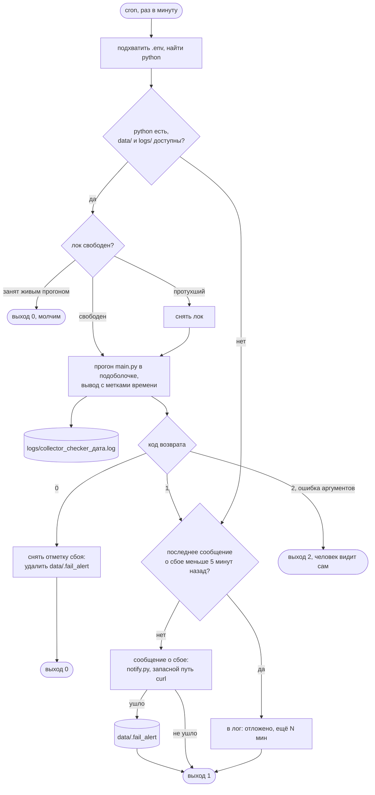
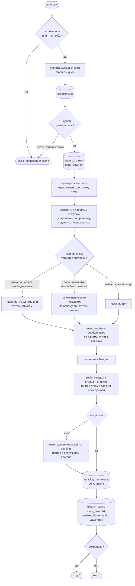
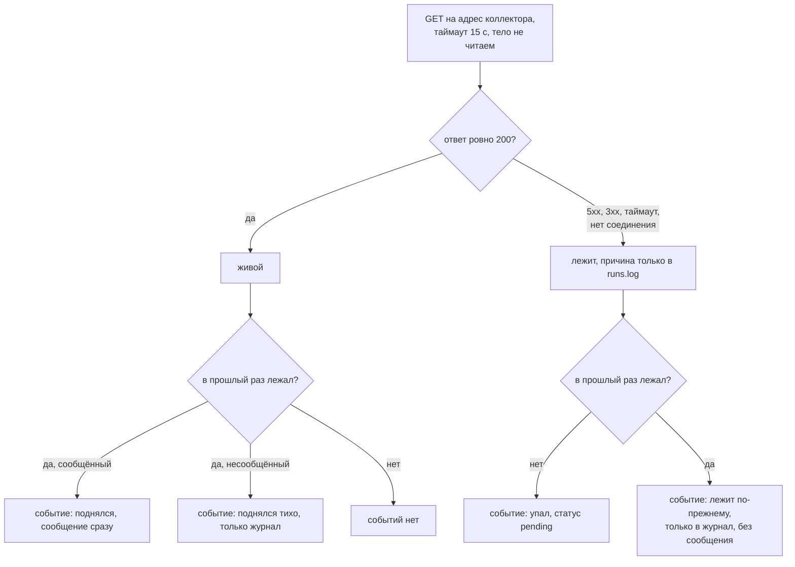

# collector_checker

Раз в минуту проверяет коллекторы веб-аналитики и пишет в Telegram, когда
коллектор перестал отвечать, пока он лежит, и когда снова ответил.

## Задача

Есть 15 коллекторов: эндпоинты, которые принимают хиты аналитики с сайтов.
Они живут на одном хосте и различаются номером в пути, `/v1` ... `/v15`.
Шестнадцатая цель это пиксель `/v16/i`: картинка в один пиксель, которую
грузят страницы без скриптов. Его проверяем голым адресом, без параметров,
чтобы ничего не записывать в аналитику, и живым считаем только 200, как
и остальные цели. Если какой-то цели нужны другие коды, в списке есть
необязательная третья колонка, например `200,404`.
Когда коллектор лежит, данные с сайтов теряются молча, и узнать об этом
хочется раньше, чем через неделю по дыре в отчётах.

Правила оповещения задал заказчик, и они проще, чем у обычного мониторинга:

- коллектор ответил 200 - жив, молчим. Любой другой исход - лежит: 500, 502,
  таймаут, нет соединения. Причину не разбираем, текст один и тот же.
  Попытка одна: не 200 с первого раза - лежит;
- первое падение: `🔴 Обнаружено падение, v7` уходит сразу и запускает
  таймер напоминаний;
- пока кто-то лежит, раз в 5 минут ровным шагом от первого падения приходит
  напоминание: `🔴 Коллектор v7 всё ещё не работает`. Упавшие позже сразу
  не сообщаются, а уходят в ближайшем напоминании вместе со всеми, кто лежит
  на этот момент. Пример: в 20:00 упал v7 - в чат падение, таймер пошёл;
  в 20:03 упал v8 - в чат ничего; в 20:05 приходят `🔴 Коллектор v7 всё ещё
  не работает` и `🔴 Коллектор v8 всё ещё не работает`; дальше 20:10, 20:15
  и так далее;
- от трёх имён в одном сообщении - один список: `🔴 Коллекторы всё ещё не работают:`
  и по строке `- Коллектор v1` на каждый. Так же и с первым падением:
  от трёх упавших в одном прогоне - `🔴 Обнаружено падение коллекторов:`
  и по строке `- Коллектор v1` на каждый;
- упал и поднялся между двумя отметками - в чат ничего, только журнал;
- подъём сообщённого коллектора: `🟢 Коллектор v7 снова работает`, сразу,
  без ожидания отметки. От трёх поднявшихся в одном прогоне - одно сообщение
  списком: `🟢 Коллектор снова работает:` и по строке `- Коллектор v8` на каждый;
- все поднялись - таймер сброшен, следующее падение снова уйдёт сразу;
- жив сам чекер - молчим, heartbeat не нужен. Если сломался сам скрипт,
  сообщение об этом приходит не чаще раза в 5 минут, хотя запуск каждую минуту.

## Как работает

Один прогон и выход, планировщика внутри нет: расписание даёт cron, раз в минуту.

1. Список коллекторов читается из `data/collectors.txt`, по строке
   `<имя> <адрес>` и необязательной третьей колонкой с допустимыми кодами.
2. На каждый адрес уходит один GET без параметров: коллектор отвечает на такой
   запрос кодом 200 и gif-пикселем, в аналитику при этом ничего не пишется. Тело
   не скачивается, нужен только код. Попытка дольше тридцати секунд обрывается
   и считается таймаутом.
3. Результат сравнивается с прошлым прогоном из `data/state.txt`. Статусов три:
   `up`, `down` (лежит, в чат сообщено) и `pending` (лежит, в чат ещё
   не сообщено: ждёт отметки таймера или повторной отправки). Новое падение
   всегда начинается с `pending`.
4. Таймер напоминаний лежит в `data/state_down.txt`: время первого падения
   и время последнего сообщения о падении. По нему решается, пора ли
   напоминать. Отметки считаются по минуте запуска, поэтому прогон в 20:05:20
   после падения в 20:00:40 уже напомнит. Если таймер потерялся, а сообщённые
   лежащие есть, напоминание уйдёт в этом же прогоне: лишнее сообщение лучше
   потерянного.
5. Сообщения уходят в Telegram напрямую через Bot API. Если имя
   `api.telegram.org` из этой сети не проходит, то же сообщение уходит
   на запасные IP тех же серверов с заголовком `Host`; сертификат проверяется
   и там. Если сообщение не ушло, коллектор остаётся `pending` (неотправленный
   подъём остаётся `down`), таймер не сдвигается, а следующий прогон отправит
   то же снова. Сбой канала не считается сбоем скрипта. Если первое падение
   нескольких коллекторов ушло частично, неушедшие (упавшие вместе с первым)
   получают сообщение "Обнаружено падение" уже следующим прогоном, не дожидаясь
   отметки; упавшие позже, когда таймер уже идёт, ждут отметки.
6. В `data/runs.log` дописываются строка о прогоне, строки о событиях и строки
   `sent` о фактически отправленном. Строки старше 7 суток срезаются (файл
   переписывается через `.tmp` и `os.replace`, обрезанного журнала не бывает),
   суточные логи в `logs/` старше 7 дней удаляются.
7. Сначала сохраняется `state.txt`, затем таймер. Если сохранить не удалось,
   прогон завершается кодом 1, и сообщения о коллекторах повторяются каждую минуту
   (падение или "всё ещё не работает"), пока запись не починят: чекер без памяти
   не отличит "упал" от "лежит", а сообщение важнее тишины (решение Вани
   2026-10-14). Раз в 5 минут `run.sh` дополнительно шлёт "прогон завершился
   ошибкой"; если недоступен и `data/`, то каждую минуту.

Отправка идёт после проверки, но до сохранения: сообщение важнее памяти.

Схемы ниже читаются сверху вниз. Обозначения одни на все три: скруглённый
блок это вход или выход, прямоугольник это шаг, ромб это развилка, цилиндр
это файл на диске.

**Обёртка `run.sh`.** Её задача не проверка, а чтобы чекер не молчал, когда
сломался он сам, и не заваливал чат, пока он сломан.



**Один прогон `main.py`.** Порядок важен: сообщения уходят раньше, чем
сохраняется состояние, и только отправленное считается сообщённым. Решает,
кому и когда писать, таймер: `plan_batches` до отправки и `settle` после неё.



**Один коллектор.** Одна попытка, итог сводится к одному признаку:
ровно 200 или нет.



```
run.sh            cron, .env, лог с метками времени, сообщение о сбое прогона
main.py           порядок прогона, коды возврата 0 / 1 / 2
modules/
  config.py       пути, таймаут, попытка, шаг напоминаний, срок хранения логов
  sources/        откуда берётся список коллекторов
    collectors.py   чтение и разбор data/collectors.txt
  probe/          проверка коллекторов
    checker.py      GET с попытками, пул потоков (по числу целей)
    failures.py     вид отказа по исключению, только для журнала
  alerting/       память, сообщения, журнал
    state.py        state.txt, события
    reminder.py     таймер напоминаний, выбор сообщений прогона
    alert.py        тексты сообщений
    notifier.py     Telegram на stdlib
    runlog.py       runs.log, чистка суточных логов
tools/notify.py   отправка готового текста, нужна run.sh
tests/            test_logic.py (логика без сети), test_e2e_local.py (локальный
                  сервер), test_run_sh.py (обёртка run.sh)
```

Состояние, таймер и журнал - обычный текст, читаются глазами и grep'ом:

```
# collector status since(MSK); pending - лежит, в чат ещё не сообщено
v1 up 2026-10-14T20:00:05
v7 down 2026-10-14T20:00:40
v8 pending 2026-10-14T20:03:10
```

`data/state_down.txt` есть, только пока таймер идёт; когда все поднялись,
файл удаляется:

```
# таймер напоминаний (MSK): last_change - падение, с которого идёт таймер;
# alert_last_sent - последнее сообщение о падении
last_change=2026-10-14T20:00:40
alert_last_sent=2026-10-14T20:05:03
```

```
2026-10-14 20:05:03 run checked=15 down=2 | v7 HTTP 503 (1 попытка), v8 timeout (1 попытка)
2026-10-14 20:05:03 event still_down v7 since 2026-10-14 20:00:40 HTTP 503
2026-10-14 20:05:03 sent remind v7, v8
```

Журнал и суточные логи хранятся 7 суток.

## Запуск

Python 3.9 или новее, единственная зависимость - `requests`.

```bash
python3 -m venv venv && venv/bin/pip install -r requirements.txt
cp data/collectors.example.txt data/collectors.txt   # вписать реальные адреса
cp .env.example .env                                 # вписать токен бота и chat id

venv/bin/python main.py --no-notify        # прогон, сообщения в stdout
./run.sh                                   # боевой прогон, лог в logs/
```

Флаги: `--no-notify` печатает сообщения вместо отправки и не требует секретов,
`--collectors ФАЙЛ`, `--state ФАЙЛ`, `--runlog ФАЙЛ` и `--logs ДИР` подменяют
пути. Таймер лежит рядом с файлом состояния, поэтому `--state` уводит оба файла.

В cron, раз в минуту:

```
* * * * * /path/to/collector_checker/run.sh > /dev/null 2>&1
```

`run.sh` подхватывает `.env`, пишет вывод в `logs/collector_checker_<дата>.log`
и, если прогон не состоялся по вине скрипта или окружения, сам шлёт об этом
сообщение с временем и хвостом лога: упавший прогон не может рассказать
о собственном падении. Такое сообщение уходит не чаще раза в 5 минут,
время последнего хранится в `data/.fail_alert`, а удачный прогон отметку
снимает. Недоступный Telegram таким сбоем не считается.

Два прогона одновременно исключает лок `data/.run.lock`: сразу после `mkdir`
обёртка пишет в него свой pid. Лок живёт, пока жива обёртка, в том числе пока
уходит сообщение о сбое, а `trap EXIT` снимает его, только если в нём свой pid. Проверено на macOS
и в Linux-контейнере (Docker, python:3.9-slim).

Коллекторы отвечают только из российской сети: с VPN все цели уходят в таймаут
по 15 секунд, и прогон длится около 15 секунд. Пока прогон идёт дольше минуты,
следующий запуск выходит по локу, и проверка этой минуты пропадает.

## Тесты

```bash
venv/bin/python -B -W ignore tests/test_logic.py        # логика, сеть не нужна
venv/bin/python -B -W ignore tests/test_e2e_local.py    # локальный http.server
venv/bin/python -B -W ignore tests/test_run_sh.py       # обёртка run.sh во временной копии
```

## Что не делаем в скрипте осознано

Причина отказа не попадает в сообщение: заказчику важен факт, разбираться
будут люди, а причина лежит в `runs.log`. Не проверяем, что коллектор
принимает и сохраняет хиты: 200 от CDN при мёртвом бэкенде этот чекер
не заметит. Подтверждения падения несколькими попытками или прогонами нет:
одно моргание сети даёт пару сообщений, упал и поднялся. Нет окон обслуживания,
heartbeat и второй точки наблюдения. Отсчёт напоминаний один на всех, а не свой
у каждого коллектора.

Адреса коллекторов, состояние, таймер, журнал и `.env` в репозиторий
не попадают, в нём только образец списка.
