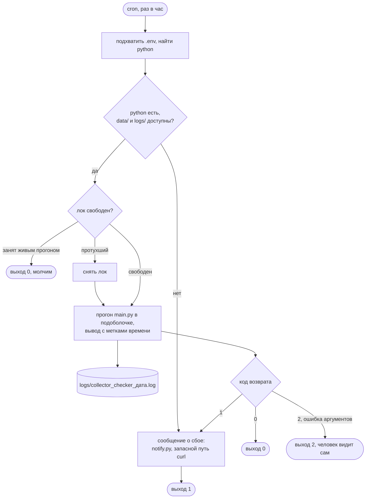
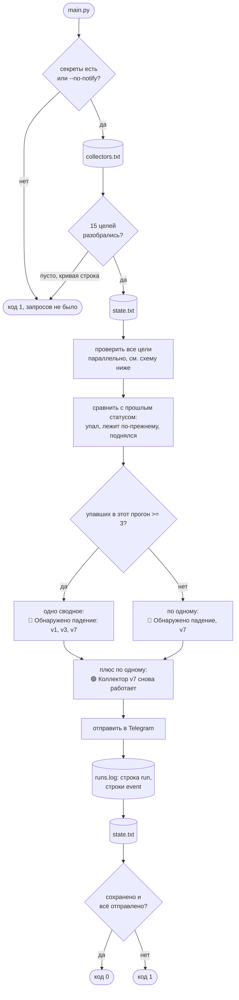
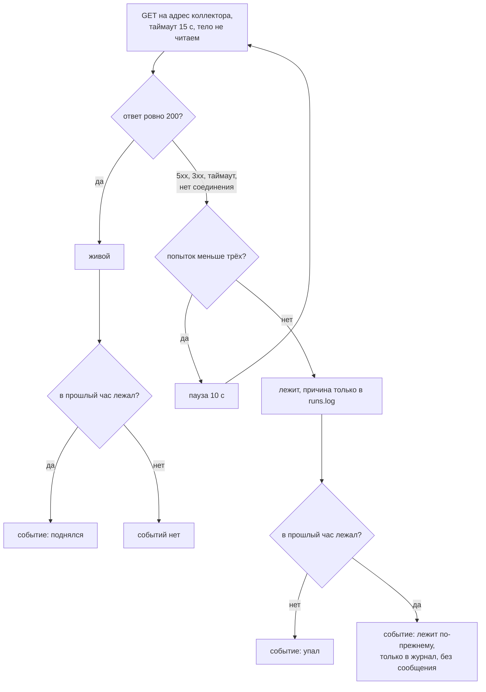

# collector_checker

Раз в час проверяет коллекторы веб-аналитики и пишет в Telegram, когда
коллектор перестал отвечать и когда снова ответил.

## Задача

Есть 15 коллекторов: эндпоинты, которые принимают хиты аналитики с сайтов.
Они живут на одном хосте и различаются номером в пути, `/v1` ... `/v15`.
Когда коллектор лежит, данные с сайтов теряются молча, и узнать об этом
хочется раньше, чем через неделю по дыре в отчётах.

Правила оповещения задал заказчик, и они проще, чем у обычного мониторинга:

- коллектор ответил 200 - жив, молчим. Любой другой исход - лежит: 500, 502,
  таймаут, нет соединения. Причину не разбираем, текст один и тот же;
- падение: `🔴 Обнаружено падение, v7`, один раз. Пока он лежит дальше, молчим;
- подъём: `🟢 Коллектор v7 снова работает`, один раз;
- от трёх упавших в одном прогоне - одно сводное сообщение:
  `🔴 Обнаружено падение: v1, v3, v7`;
- жив сам чекер - молчим, heartbeat не нужен.

## Как работает

Один прогон и выход, планировщика внутри нет: расписание даёт cron.

1. Список коллекторов читается из `data/collectors.txt`, по строке
   `<имя> <адрес>`.
2. На каждый адрес уходит GET без параметров: коллектор отвечает на такой запрос
   кодом 200 и gif-пикселем, в аналитику при этом ничего не пишется. Тело
   не скачивается, нужен только код.
3. Ответ не 200 проверяется ещё дважды с паузой в десять секунд. Подтверждать
   падение следующим прогоном нельзя, он через час, поэтому одиночное сетевое
   моргание гасится внутри прогона.
4. Результат сравнивается с прошлым прогоном из `data/state.txt`. Отсюда
   три события: упал, лежит по-прежнему, поднялся. Сообщения дают первое и третье,
   второе остаётся в журнале.
5. По событиям собираются сообщения и уходят в Telegram. Строка о прогоне
   и строки о событиях дописываются в `data/runs.log`.
6. Состояние сохраняется. Если сохранить не удалось, прогон завершается
   кодом 1: чекер без памяти не отличит "упал" от "лежит" и потеряет
   сообщение о подъёме, а снаружи это ничем не видно, кроме кода возврата.

Отправка идёт после проверки, но до сохранения: сообщение важнее памяти.

Схемы ниже читаются сверху вниз. Обозначения одни на все три: скруглённый
блок это вход или выход, прямоугольник это шаг, ромб это развилка, цилиндр
это файл на диске.

**Обёртка `run.sh`.** Её задача не проверка, а чтобы чекер не молчал, когда
сломался он сам.



**Один прогон `main.py`.** Порядок важен: сообщения уходят раньше, чем
сохраняется состояние.



**Один коллектор.** Три попытки гасят короткое моргание, а итог сводится
к одному признаку: ровно 200 или нет.



```
run.sh            cron, .env, лог с метками времени, сообщение о сбое прогона
main.py           порядок прогона, коды возврата 0 / 1 / 2
modules/
  config.py       пути, таймаут, попытки, порог сводного сообщения
  sources/        откуда берётся список коллекторов
    collectors.py   чтение и разбор data/collectors.txt
  probe/          проверка коллекторов
    checker.py      GET с попытками, пул потоков
    failures.py     вид отказа по исключению, только для журнала
  alerting/       память, сообщения, журнал
    state.py        state.txt, события
    alert.py        тексты сообщений
    notifier.py     Telegram на stdlib
    runlog.py       runs.log
tools/notify.py   отправка готового текста, нужна run.sh
tests/            логика без сети и e2e на локальном сервере
```

Состояние и журнал - обычный текст, читаются глазами и grep'ом:

```
# collector status since(MSK)
v1 up 2026-10-12T16:00:05
v7 down 2026-10-12T15:00:03
```

```
2026-10-12 16:00:05 run checked=15 down=1 | v7 HTTP 503 (3 попытки)
2026-10-12 16:00:05 event down v7 since 2026-10-12 16:00:05 HTTP 503
```

## Запуск

Python 3.9 или новее, единственная зависимость - `requests`.

```bash
python3 -m venv venv && venv/bin/pip install -r requirements.txt
cp data/collectors.example.txt data/collectors.txt   # вписать реальные адреса
cp .env.example .env                                 # вписать токен бота и chat id

venv/bin/python main.py --no-notify        # прогон, сообщения в stdout
./run.sh                                   # боевой прогон, лог в logs/
```

Флаги: `--no-notify` печатает сообщения вместо отправки и не требует секретов,
`--collectors ФАЙЛ`, `--state ФАЙЛ` и `--runlog ФАЙЛ` подменяют пути.

В cron, раз в час:

```
0 * * * * /path/to/collector_checker/run.sh > /dev/null 2>&1
```

`run.sh` подхватывает `.env`, пишет вывод в `logs/collector_checker_<дата>.log`
и, если прогон не состоялся, сам шлёт об этом сообщение: упавший прогон
не может рассказать о собственном падении. Проверено на macOS и в Linux-контейнере
(Docker, python:3.9-slim).

## Тесты

```bash
venv/bin/python tests/test_logic.py        # логика, сеть не нужна
venv/bin/python tests/test_e2e_local.py    # локальный http.server
```

## Что не делаем

Причина отказа не попадает в сообщение: заказчику важен факт, разбираться
будут люди, а причина лежит в `runs.log`. Не проверяем, что коллектор
принимает и сохраняет хиты: 200 от CDN при мёртвом бэкенде этот чекер
не заметит. Нет окон обслуживания, heartbeat и второй точки наблюдения.

Адреса коллекторов, состояние, журнал и `.env` в репозиторий не попадают,
в нём только образец списка.
