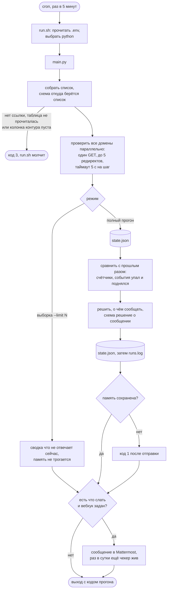
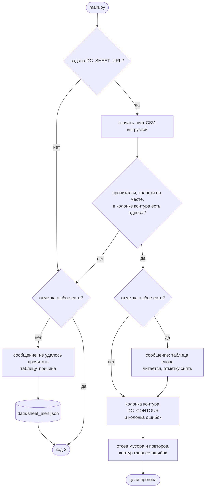
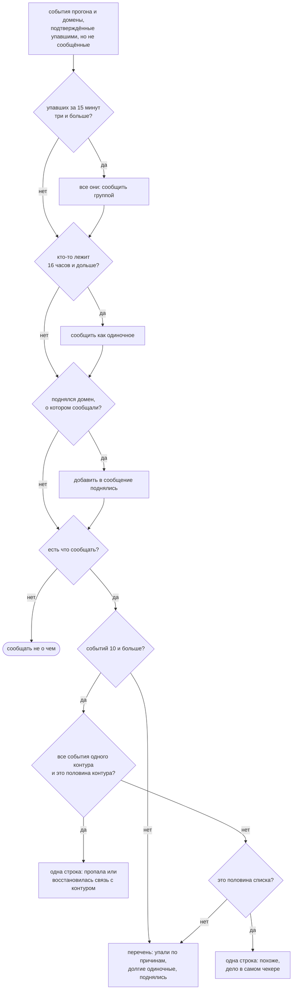
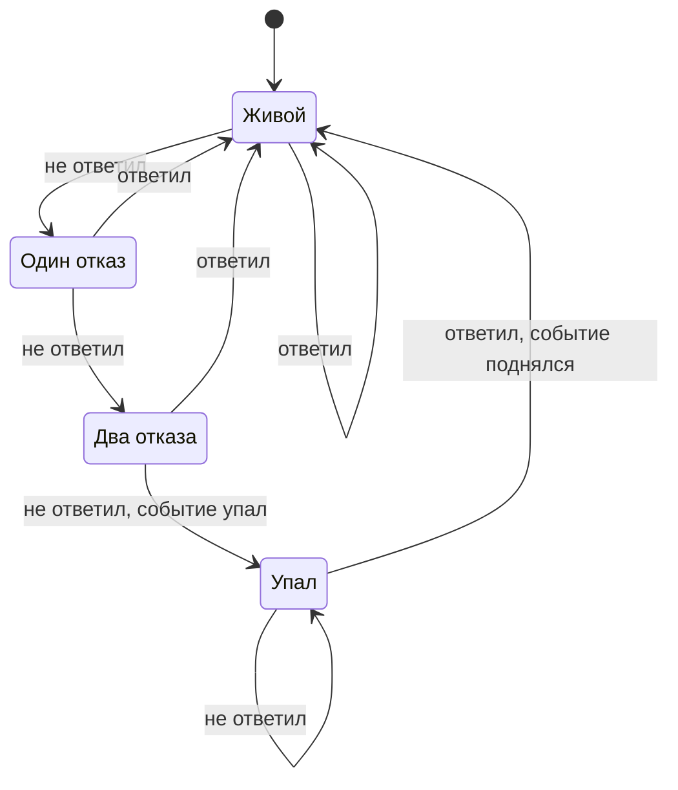
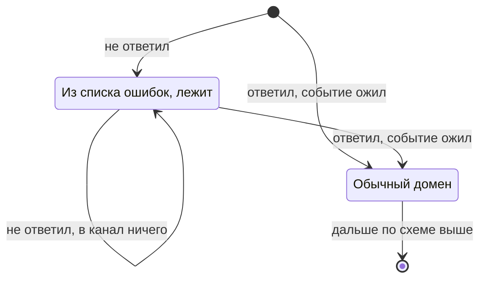
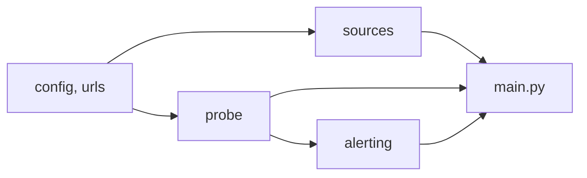

# domain_checker

Раз в пять минут проверяет список доменов одним HTTP-запросом каждый и пишет
в Mattermost, когда сайты легли или поднялись. Помнит прошлые прогоны, поэтому
сообщает не о каждом сбое, а о смене состояния, и не на каждую, а по правилам
ниже: канал не должен зашуметь.

Документ для тех, кто будет запускать и поддерживать чекер. Порядок разделов: зачем он,
что на входе и выходе, правила канала, как устроен прогон (схемы), архитектура,
сообщения и журнал, как реагировать на типовые ситуации, установка, запуск, тесты,
настройки, что поддерживает, словарь.

## 1. Зачем

Узнать, что сайт перестал отвечать, раньше, чем об этом сообщат пользователи. Важен
только факт: домен жив или нет. Причина, место и подробности отказа роли не играют,
разбираться в них будут люди.

Проверка раз в пять минут накладывает два ограничения, которые определили почти все
решения в проекте.

**Прогон обязан укладываться в окно.** Если проверка списка занимает больше пяти минут,
запуски наползают друг на друга. Поэтому домены проверяются параллельно, тела страниц
не скачиваются, а таймаут на запрос короткий. Полный список из нескольких сотен адресов
проходится за секунды.

**Канал не должен зашуметь.** Один упавший домен при таком интервале дал бы 288
сообщений в сутки. Поэтому сообщение уходит только на смену состояния, и не на каждую:
групповое падение сразу, одиночное через 16 часов, подъём только про сообщённое.

## 2. Вход и выход

| Что | Где | Формат |
|---|---|---|
| Список доменов | Google-таблица по ссылке из `DC_SHEET_URL` | один лист, колонки "ошибки", "внутренний", "внешний"; берётся колонка контура `DC_CONTOUR` и колонка ошибок. Других источников нет |
| Секреты | `.env` | `DC_MATTERMOST_WEBHOOK` и `DC_SHEET_URL`; шаблон в `.env.example`, там стоит ссылка-пример |
| Сообщения | Mattermost | через Incoming Webhook |
| Память | `data/state.json` | счётчик отказов и статус каждого домена |
| Отметка о сбое таблицы | `data/sheet_alert.json` | есть, пока таблица не читается и об этом уже сообщили |
| Журнал | `data/runs.log` | строка на прогон и на событие, около двух месяцев |
| Код возврата | 0, 1, 2, 3 | прогон состоялся; не состоялся или память не сохранена; ошибка аргументов; не прочиталась таблица |

Адреса без схемы получают `https://`. Мусорные строки отсеиваются, повторы схлопываются:
`example.com/` и `EXAMPLE.com` это один домен.

### Google-таблица

Список удобнее держать в Google-таблице. Поправить его может любой, у кого есть доступ,
а чекер подхватит изменения на следующем прогоне, через пять минут. Таблица одна, лист
один, заголовки колонок в первой строке. Колонки чекер ищет по началу слова, так что
"Внешний контур" тоже подойдёт.

| Колонка | Что в ней | Как с ней работает чекер |
|---|---|---|
| ошибки | сайты, которые давно не отвечают | проверяет при любом контуре, но пока они лежат, канал молчит |
| внутренний | сайты внутренней сети | проверяет при `DC_CONTOUR=2` |
| внешний | публичные сайты | проверяет при `DC_CONTOUR=1`, так по умолчанию |

Сайт, который стоит и в колонке контура, и в ошибках, считается контурным: о его
падении канал узнает как обычно.

Доступ нужен только на чтение. В таблице "Настройки доступа" → "Все, у кого есть ссылка" →
"Читатель". Чекер скачивает лист CSV-выгрузкой, без ключей и сторонних библиотек. Цена
простоты в том, что ссылка даёт прочитать список любому, к кому она попадёт. Поэтому
ссылка лежит в `.env` рядом с вебхуком, а не в коде.

С машины проверки должны открываться `docs.google.com` и `*.googleusercontent.com`.
Второй адрес легко забыть: Google отдаёт выгрузку через редирект именно на него.

## 3. Правила: что и когда попадает в канал

Домен живой, если сервер ответил кодом от 200 до 399 включительно. Всё остальное,
включая отсутствие ответа, это сбой. Содержимое страницы не разбирается.

- **Подтверждение.** Домен признаётся упавшим после трёх неудачных прогонов подряд.
  Короткое сетевое моргание тревогу не поднимает; цена подтверждения - десять минут.
- **Групповое падение.** Не меньше трёх доменов, подтверждённых упавшими в окне
  15 минут: одно сообщение сразу. Окно, а не один прогон: во всплесках домены ложатся
  в два-три соседних прогона.
- **Одиночное падение.** Домен вне группы попадает в канал, только когда не отвечает
  16 часов подряд. Всё, что короче, остаётся в журнале.
- **Подъём.** Уходит только про домены, о падении которых сообщали.
- **Предохранители.** Если разом упало или вернулось полсписка либо целый контур,
  вместо перечня уходит одна строка про машину проверки: дело почти наверняка в сети
  или DNS на ней, а не в сотне независимых аварий.
- **Признак жизни.** Раз в сутки короткое "чекер жив, проверено N, не отвечают M".
  Пропажа этого сообщения сама становится тревогой.
- **Сбой прогона.** Если `main.py` вернул ненулевой код, обёртка `run.sh` сама шлёт
  в канал строку с хвостом вывода: упавший прогон не может рассказать о себе.
- **Колонка ошибок.** Сайт оттуда сразу записывается в память как упавший и уже
  сообщённый, поэтому ни группа, ни 16 часов его в канал не вынесут. Ожил - приходит
  "Ожили из списка ошибок" с просьбой перенести его в колонку контура. Дальше он живёт
  по обычным правилам, даже если в таблице его так и не перенесли.
- **Таблица не прочиталась.** Прогон останавливается с кодом 3, в канал уходит одно
  сообщение с причиной. Каждые пять минут оно не повторяется. Когда таблица снова
  прочитается, придёт ещё одно, и проверка пойдёт дальше.

Одной таблицей:

| Ситуация | Что в канале |
|---|---|
| домен не ответил один или два прогона | ничего, счётчик растёт |
| три прогона подряд не ответил | ничего, домен ждёт группы или 16 часов; в журнале "упал" |
| за 15 минут подтвердились три и больше | "Упали: N" сразу, со списком по причинам |
| одиночный домен лежит 16 часов | "Не отвечают дольше 16 часов" |
| поднялся домен, о котором сообщали | "Поднялись: N" |
| поднялся домен, о котором не сообщали | ничего, только журнал |
| упало или вернулось полсписка или целый контур | одна строка про машину проверки, без списка |
| раз в сутки | "Чекер жив" |
| прогон не состоялся или память не сохранена | "Прогон чекера не состоялся", от обёртки |
| сайт из колонки ошибок не отвечает | ничего, в журнале только число |
| сайт из колонки ошибок ответил | "Ожили из списка ошибок" с просьбой перенести в таблице |
| таблица не прочиталась | одно сообщение с причиной, дальше тишина до починки |
| таблица снова читается | "Google-таблица снова читается" |
| Mattermost не принял сообщение | повтора нет, событие считается сообщённым |

## 4. Как устроен прогон

Один прогон и выход, планировщика внутри нет: расписание даёт cron или systemd.

Схемы читаются сверху вниз. Обозначения одни на все: скруглённый блок это вход или
выход, прямоугольник это шаг, ромб это развилка, цилиндр это файл на диске.

**Прогон целиком.** Память и журнал сохраняются до отправки: события уже посчитаны,
терять их из-за недоступного канала незачем. А вот память, которую не удалось записать,
роняет прогон кодом 1: без неё счётчик отказов каждый раз начинался бы с нуля и до трёх
не дошёл бы никогда, канал молчал бы так же, как при исправной работе.



**Откуда берётся список.** Единственный источник - таблица по ссылке из `.env`. Нет ссылки,
таблица не прочиталась или в колонке контура нет адресов - всё это один и тот же сбой таблицы.
Он не роняет прогон обычным кодом 1, иначе обёртка писала бы о нём каждые пять минут. Вместо
этого чекер сам сообщает один раз и ставит отметку, а снимает её первым удачным чтением.



Выборка `--limit N` таблицу читает так же, но в канал о сбое не пишет: её запускает
человек в терминале, и причину он видит сразу.

**Решение о сообщении.** После сравнения с памятью у чекера есть события "упал"
и "поднялся". Событие ещё не сообщение: падение ждёт группы или срока, подъём
проходит, только если о падении сообщали, а поверх стоят предохранители.



**Жизнь одного домена в памяти.** События рождаются только на переходах с подписью.
Один или два отказа между ответами не дают ничего.



**Сайт из колонки ошибок.** У него своя короткая жизнь до первого ответа. Пока он лежит,
событий нет вовсе: счётчик растёт, но запись сразу помечена сообщённой. Первый ответ
даёт событие "ожил" и снимает особый режим навсегда, отметка `promoted` в памяти держит
его обычным, пока сайт есть в таблице.



Отметка "сообщено" ставится в момент, когда чекер решил отправить, а не когда канал
принял. Если Mattermost не ответил, повтора не будет: событие уже числится сообщённым,
а позже по этому домену придёт "поднялся" без "упал". Это известная недоработка,
событие при этом есть в журнале.

## 5. Архитектура

Три слоя плюс два общих модуля. Каждый слой читается, не зная внутренностей соседнего.

```
run.sh                запуск по расписанию, подхватывает .env, шлёт сообщение о сбое
main.py               один прогон и выход, коды возврата 0 / 1 / 2 / 3
modules/
  config.py           настройки и пороги, московское время
  urls.py             нормализация адреса, отсев мусора
  sources/            откуда берётся список
    sheet.py          чтение Google-таблицы CSV-выгрузкой, причины сбоя простыми словами
    targets.py        отсев, повторы, метки контуров и колонки ошибок, пустой контур как сбой таблицы
  probe/              как проверяется домен
    checker.py        один GET с редиректами, пул потоков
    failures.py       вид отказа по исключению requests
  alerting/           что делать с результатом
    state.py          память между запусками, подтверждение, выбор событий для канала
    alert.py          тексты сообщений и предохранители
    runlog.py         журнал прогонов и его обрезка
    notifier.py       POST в Mattermost на stdlib
tools/
  notify.py           отправить готовый текст в Mattermost, нужна run.sh
tests/
  test_logic.py       59 тестов, сеть не нужна
  test_e2e_local.py   6 проверок на локальных серверах
```

Зависимости идут в одну сторону: `config` и `urls` ни от чего не зависят, `sources`
и `probe` стоят на них, `alerting` стоит на `probe`, `main.py` знает только про пакеты.



Формы данных, которые ходят между слоями:

```python
# цель проверки, собирается в sources
{"url": "https://example.com", "label": "example.com", "contour": "external",
 "known_bad": False}       # True для сайта из колонки ошибок

# результат проверки одной цели, отдаёт probe
{"url": ..., "label": ..., "contour": ..., "known_bad": False,
 "ok": False,              # пришёл ответ и его код попал в 200..399
 "status_code": 500,       # None, если ответа не было вовсе
 "failure_kind": None,     # когда ответа не было: dns, tls, timeout, ...
 "error": None}            # текст исключения, когда ответа не было

# память между запусками, по записи на домен
{"version": 1, "updated_at": "...", "last_heartbeat": "...",
 "domains": {"example.com": {"fails": 1, "down": False, "since": None},
             "dead.example.com": {"fails": 7, "down": True,
                                  "since": "2026-10-05T09:15:00", "reported": False,
                                  "url": "https://dead.example.com",
                                  "contour": "external", "reason": "HTTP 503"}}}

# событие смены статуса; в канал попадает после отбора
{"event": "down", "label": ..., "url": ..., "since": ...,
 "contour": "internal", "reason": "HTTP 500", "alert": "group"}
```

## 6. Сообщения и журнал

Все сообщения в канал идут моноширинным блоком с подвалом "Проверено N · дата МСК".

| Заголовок | Когда | Что внутри |
|---|---|---|
| 🔴 Упали: N | группа или одиночное | упавшие по причинам, крупные группы сверху; отдельно "Не отвечают дольше 16 часов" |
| 🟢 Поднялись: N | подъём сообщённого | домен и с какого времени не отвечал |
| ⚠️ Похоже, пропала связь с внутренним или внешним контуром | предохранитель по контуру | сколько доменов контура из скольких, без списка |
| 🟢 Похоже, восстановилась связь с контуром | тот же предохранитель на подъём | то же |
| ⚠️ Похоже, дело в самом чекере | предохранитель по доле списка, и на падение, и на восстановление | сколько доменов из скольких, без списка |
| 🟢 Чекер жив | раз в сутки | проверено N, не отвечают M |
| 🔥 Прогон чекера не состоялся (код N) | от обёртки | хост, каталог, время, последние строки вывода |
| 🟢 Ожили из списка ошибок: N | сайт из колонки ошибок ответил | адреса и просьба перенести их в колонку контура |
| ⚠️ Не удалось прочитать Google-таблицу со списком доменов | первый прогон, где таблица не прочиталась | причина простыми словами, например "таблица закрыта"; повторов нет |
| 🟢 Google-таблица снова читается | первый прогон после сбоя | с какого времени не читалась |

Канал показывает только то, о чём решено сообщать, память хранит сегодняшний срез.
Ни по тому, ни по другому нельзя ответить, лежал ли домен вчера и все ли прогоны
состоялись. Для этого есть `data/runs.log`: строка на каждый боевой прогон и на каждое
событие, обычный текст.

```
2026-10-02 13:35:12  прогон    проверено 126, не ответили 2: old.example.com (TLS-рукопожатие не состоялось (устаревший протокол или шифр)), shop.example.com/ (HTTP 404)
2026-10-02 13:35:12  упал      old.example.com - TLS-рукопожатие не состоялось (устаревший протокол или шифр)
2026-10-02 13:35:12  поднялся  shop.example.com/ - не отвечал с 2026-09-21 12:05
2026-10-23 11:11:17  прогон    проверено 315, не ответили 118 (из списка ошибок 116): lk.example.com (HTTP 503), ...
2026-10-23 11:11:17  ожил      wiki.example.com (из списка ошибок)
```

Сайты из колонки ошибок в строке прогона только посчитаны, без имён. Их больше сотни, лежат
они каждый прогон, и с именами строка росла бы на несколько килобайт каждые пять минут.

`grep упал data/runs.log` даёт все падения, `grep -c прогон` за день показывает, сколько
прогонов состоялось (должно быть 288), `grep old.example.com` даёт историю одного домена.
Имена не ответивших попадают в строку прогона независимо от того, ушло ли сообщение:
одиночный отказ, не дошедший до порога, виден только здесь. Файл обрезается
до 20 000 строк, это около двух месяцев. Выборка `--limit N` в журнал не пишет.

Виды отказа, как они подписаны в журнале: домен не резолвится (dns);
TLS-рукопожатие не состоялось, в том числе просроченный или чужой сертификат (tls);
сервер не ответил за отведённое время (timeout); соединение отвергнуто или оборвано
(refused); бесконечная цепочка редиректов (redirect_loop); прокси не пропустил (proxy);
строка не является адресом (invalid_url); прочая ошибка (other). Ответ с кодом вне
200..399 подписывается самим кодом, например "HTTP 503".

В сообщении в канал у причины короткое имя (Тайм-аут, DNS, TLS, Отказ соединения,
Редиректы по кругу, Прокси, Не адрес, Прочая ошибка или код вроде HTTP 503), а строкой
ниже - пояснение простыми словами: сайт открылся с ошибкой или не открылся совсем, и почему.

## 7. Как реагировать

| Ситуация | Что проверить | Что сделать |
|---|---|---|
| "Упали: N" со списком | открыть пару адресов руками с машины проверки и из своей сети; причины в сообщении | если причины разные и сайты не открываются ниоткуда - владельцам сайтов; если у всех dns или timeout - смотреть сеть машины проверки |
| "Похоже, пропала связь с контуром" или "дело в самом чекере" | сеть, DNS, прокси, VPN на машине проверки; `./run.sh --limit 12` покажет текущую картину | чинить машину или маршрут; когда связь вернётся, придёт такое же сообщение о восстановлении, список доменов не нужен |
| "Не отвечают дольше 16 часов" | это одиночные домены, реально лежат с указанного времени | владельцам сайтов; в журнале по `grep <домен>` видна вся история |
| "Поднялись" без "Упали" перед ним | `grep упал data/runs.log` за последние дни | сообщение о падении потерялось (канал не принял) либо падение было одиночным и до 16 часов не дожило; журнал всё помнит |
| "Прогон чекера не состоялся" | текст: неверный `DC_CONTOUR`, состояние не сохранено (права на `data/`), трассировка python | поправить `.env`, права или окружение; пока прогон не состоялся, падения не отслеживаются |
| "Чекер жив" не приходил больше суток | `grep -c прогон data/runs.log` за сегодня (должно быть 288), расписание cron, права, `.env` | чекер не запускается или не доходит до отправки; смотреть вывод `./run.sh` руками |
| Канал молчит, а сайт точно лежит | `grep <домен> data/runs.log` | одиночное падение видно в канале только через 16 часов, это норма; в журнале событие есть сразу после подтверждения |
| Нужно посмотреть, что не отвечает прямо сейчас | - | `./run.sh --limit N`; не `--no-notify`: тот на полном прогоне меняет память |
| Нужно добавить или убрать домен | Google-таблица, колонка контура или ошибок | править таблицу, чекер подхватит через пять минут; убранный домен выпадает из памяти в следующем прогоне |
| Много ложных отказов с кодом 403 или 406 | журнал: один и тот же код у многих доменов | защита от ботов режет наш `User-Agent`; договариваться с владельцами защиты об исключении |
| Все внешние домены упали после переезда на новый сервер | есть ли на сервере прокси | `DC_TRUST_ENV=1` в `.env`, если выход в интернет только через прокси |
| Каталог со скриптом переустанавливается | - | память и журнал увести в постоянное место через `DC_STATE_FILE` и `DC_RUNLOG_FILE` |

## 8. Установка и зависимости

Раздел расписан по шагам, команды можно копировать как есть. Где команды для разных систем
отличаются, это сказано. Linux-команды проверены 22.10.2026 в чистых Ubuntu 24.04,
Rocky Linux 9 и Debian 12, команды для macOS на Mac с Apple Silicon. Все Linux-проверки шли
на ARM-сборках, на обычном сервере x86_64 команды те же.

### Что понадобится

| Что | Версия | Зачем |
|---|---|---|
| Python | 3.8 и новее, проверено на 3.8, 3.9 и 3.12 | на 3.7 и старше не проверялось, см. шаг 2 |
| requests | 2.31 и новее | HTTP-запросы к доменам |
| bash, mktemp | есть в любой системе | нужны обёртке `run.sh` |
| cron | только для расписания | запуск раз в пять минут, раздел 9 |

Чтение таблицы и отправка в Mattermost написаны на стандартной библиотеке Python, единственная
библиотека - requests. Выход в интернет нужен на время установки, к PyPI за библиотекой,
и в работе - к `docs.google.com`, проверяемым доменам и Mattermost.

### Шаг 1. Узнать систему и версию Python

```bash
cat /etc/os-release        # Linux: строки NAME и VERSION_ID
sw_vers                    # macOS: ProductVersion
python3 --version          # какой Python вызывается по умолчанию
ls /usr/bin/python3*       # какие ещё версии уже стоят в системе
```

Если `python3 --version` показывает 3.8 или новее, переходите к шагу 3. Это верно почти
для всех живых систем: Ubuntu 20.04 и новее, Debian 11 и новее, RHEL, Rocky и Alma 9
(там 3.9), macOS (там 3.9). Если 3.7 и старше или `command not found`, нужен шаг 2.

### Шаг 2. Поставить подходящий Python

Нужен, только если шаг 1 показал версию старше 3.8 или Python нет вовсе. Системный `python3`
не заменяйте и не удаляйте: на нём работают утилиты самой системы. Новый Python ставится
рядом.

**Ubuntu, Debian.** Python из системы подходит, не хватает модуля виртуальных окружений:

```bash
sudo apt-get update
sudo apt-get install -y python3 python3-venv
python3 --version
```

**RHEL, Rocky, Alma 9.** Python 3.9 в системе подходит, достаточно pip:

```bash
sudo dnf install -y python3 python3-pip
python3 --version
```

**Старые системы (CentOS 7 и подобные с Python 3.6) или нет прав root: uv.** uv скачивает
готовую сборку Python в домашний каталог пользователя. Права root не нужны, системный Python
остаётся как был. Нужен выход в интернет к `astral.sh` и `github.com`.

```bash
curl -LsSf https://astral.sh/uv/install.sh | sh
export PATH="$HOME/.local/bin:$PATH"     # или откройте новый терминал
uv python install 3.12
```

Если `curl` нет: `sudo apt-get install -y curl ca-certificates`. Ставьте uv под тем
пользователем, от имени которого чекер будет работать по расписанию: Python ляжет в его
`~/.local/share/uv/python/`, и окружение из шага 4 будет ссылаться на эту папку.

**macOS.** Встроенный `python3` (3.9) подходит. Если терминал при первом вызове `python3`
предлагает установить инструменты разработчика, согласитесь: это и есть встроенный Python.

### Шаг 3. Положить папку чекера на место

Linux:

```bash
sudo mkdir -p /opt/domain-checker
sudo chown "$USER": /opt/domain-checker
cp -r ~/main_domain_checker/. /opt/domain-checker/    # слева путь, куда вы распаковали папку
cd /opt/domain-checker
ls                                                    # README.md main.py modules requirements.txt run.sh tests tools
```

macOS: держите папку вне "Рабочего стола", "Документов" и "Загрузок", например
`~/domain-checker`. Из этих трёх каталогов cron без отдельного разрешения ничего
не запустит, подробности в разделе 9.

Все дальнейшие команды выполняются из папки чекера.

### Шаг 4. Виртуальное окружение и библиотеки

Виртуальное окружение - папка `venv` со своим Python и библиотеками только для чекера.
Назовите её именно `venv`: `run.sh` ищет `venv/bin/python`, а без неё берёт системный
`python3`, в котором библиотек нет. Создайте окружение той строкой, которая соответствует
способу установки Python:

```bash
python3 -m venv venv                  # Ubuntu, Debian, RHEL, Rocky, Alma, macOS
uv venv --python 3.12 --seed venv     # uv; без --seed в окружении не будет pip
```

Проверьте версию и поставьте библиотеки:

```bash
venv/bin/python --version             # должно быть 3.8 или новее
venv/bin/pip install -r requirements.txt
```

Установка занимает несколько секунд. Предупреждение `You are using pip version ...;
however, version ... is available` на работу не влияет. На macOS при запуске может
появляться `NotOpenSSLWarning: urllib3 v2 only supports OpenSSL 1.1.1+` - тоже безвредно.

### Шаг 5. Настройки и адрес вебхука

Настройки живут в файле `.env` рядом с `run.sh`. Создайте его из образца и откройте:

```bash
cp .env.example .env
chmod 600 .env                 # адрес вебхука - секрет, читать может только владелец
nano .env                      # сохранить Ctrl+O, Enter; выйти Ctrl+X
```

Что заполнить:

- `DC_MATTERMOST_WEBHOOK=` - адрес Incoming Webhook канала, без кавычек. Пусто - сообщения
  не отправляются, прогон всё равно идёт.
- `DC_SHEET_URL=` - ссылка на Google-таблицу прямо из адресной строки браузера, вида
  `https://docs.google.com/spreadsheets/d/.../edit#gid=0`. В образце стоит ссылка-пример,
  её нужно заменить: с ней прогон остановится кодом 3, как и с пустой строкой.
- `DC_CONTOUR=` - `1` внешний контур, `2` внутренний. Любое другое значение остановит
  прогон с понятной ошибкой.
- Остальные строки можно не трогать, их смысл описан в разделе 11.

### Шаг 6. Проверить установку

```bash
chmod +x run.sh                           # после zip или передачи через Windows бит исполнения теряется
venv/bin/python tests/test_logic.py       # "Все 59 тестов пройдены.", около секунды
venv/bin/python tests/test_e2e_local.py   # "Все 6 проверок пройдены.", около 5 секунд
./run.sh --limit 5                        # пробный прогон по таблице, состояние не трогает
```

Пробный прогон печатает строку `Целей: ...` с числами по таблице, сводку о не ответивших
доменах и в конце строки `Выборка 5 адресов: состояние не трогаю.` и, если вебхук не задан,
`Вебхук не задан (DC_MATTERMOST_WEBHOOK), отправка пропущена.` Если вместо этого
`Google-таблица не прочитана: ...` и код 3 - причина в той же строке: не заменена
ссылка-пример, таблица закрыта или нет связи с `docs.google.com`.

Первый полный прогон:

```bash
./run.sh
echo $?                                   # 0 - прогон состоялся
ls -l data/                               # появились state.json и runs.log
```

В первом полном прогоне предупреждение `Состояние не найдено ... В первом запуске это норма`
ожидаемо.

### Частые ошибки при установке

| Что видно | Причина | Что сделать |
|---|---|---|
| `No matching distribution found for requests>=2.31` | Python 3.6 или старше | шаг 2, затем `rm -rf venv` и шаг 4 заново |
| `ensurepip is not available ... apt install python3.12-venv` | нет пакета `python3-venv` | `sudo apt-get install -y python3-venv`, затем `rm -rf venv` (папка осталась недособранной) и шаг 4 |
| `error: externally-managed-environment` | вызван системный `pip`, а не из окружения | ставить через `venv/bin/pip` |
| `venv/bin/pip: No such file or directory` | окружение создано uv без `--seed` | `rm -rf venv`, `uv venv --python 3.12 --seed venv` |
| `./run.sh: Permission denied` | нет бита исполнения | `chmod +x run.sh` |
| `No module named 'requests'` при `./run.sh` | окружения нет или оно не в папке `venv` | шаг 4 |

## 9. Запуск

```bash
./run.sh                                # боевой прогон: весь список, меняет память и журнал
./run.sh --limit 12                     # выборка: сводка о проблемах, память не трогается
./run.sh --no-notify                    # не отправлять; память на полном прогоне всё равно пишется
./run.sh --help
venv/bin/python main.py --limit 5       # то же без обёртки: .env не подхватывается
```

В свежей копии сначала нужна ссылка на таблицу в `.env`: без неё прогон останавливается
кодом 3. Без `DC_MATTERMOST_WEBHOOK` отправки нет, и в выводе про это сказано прямо.

Флаг `--no-notify` только отключает отправку. Полный прогон с ним всё равно обновляет
память, пишет журнал и помечает падения сообщёнными, так что следующий боевой прогон
о них уже не напишет. Для ручной проверки "что сейчас не отвечает" нужен `--limit`.

### Запуск по расписанию (cron)

Чекер рассчитан на запуск раз в пять минут. В расписание ставится `run.sh`: он сам
переходит в свою папку, подхватывает `.env` и берёт Python из `venv`, поэтому в строке
расписания достаточно полного пути к нему.

**1. Убедиться, что cron стоит и запущен.** На macOS он встроен, шаг пропустите.

```bash
# Ubuntu, Debian
sudo apt-get install -y cron
sudo systemctl enable --now cron
systemctl status cron            # ожидается active (running)

# RHEL, Rocky, Alma
sudo dnf install -y cronie
sudo systemctl enable --now crond
systemctl status crond           # ожидается active (running)
```

Часовой пояс машины (`date`) для этого чекера не важен: расписание - каждые пять минут,
а время в сообщениях и журнале код сам пишет по Москве.

**2. Подготовить папку.** Чекер установлен по разделу 8, `./run.sh` вручную отработал
с кодом 0, `.env` заполнен. Создайте каталог для вывода cron:

```bash
cd /opt/domain-checker
mkdir -p logs
```

Без каталога `logs` cron не сможет открыть файл для вывода и молча не запустит прогон.

**3. Добавить строку в расписание.** Расписание у каждого пользователя своё. Открывайте его
под тем пользователем, который ставил окружение, без `sudo`:

```bash
EDITOR=nano crontab -e
```

Откроется редактор. Вставьте строку в конец файла, сохраните `Ctrl+O`, `Enter`,
выйдите `Ctrl+X`. Ответ `crontab: installing new crontab` значит, что расписание принято.

Строка для Linux:

```cron
*/5 * * * * /opt/domain-checker/run.sh >> /opt/domain-checker/logs/cron.log 2>&1
```

- `*/5` в первом поле - каждые пять минут, в остальных звёздочки - каждый час и день.
- Путь к `run.sh` и к логу полный: cron стартует из домашнего каталога пользователя.
- Писать вывод в `/var/log/...` можно, только если расписание принадлежит root: у обычного
  пользователя туда нет прав, и прогон молча не запустится.

Строка для macOS:

```cron
*/5 * * * * /Users/<имя>/domain-checker/run.sh >> /Users/<имя>/domain-checker/logs/cron.log 2>&1
```

- Если папка всё же лежит в "Рабочем столе", "Документах" или "Загрузках", cron нужно
  дать доступ: "Системные настройки" → "Конфиденциальность и безопасность" → "Доступ
  к диску", кнопкой "+" добавить `/usr/sbin/cron` (в окне выбора `Cmd+Shift+G`
  и вставить путь).
- Пока Mac спит, прогоны не идут: для постоянного мониторинга нужна машина, которая
  не засыпает.

**4. Проверить через 10 минут.**

```bash
crontab -l                       # строка на месте
tail logs/cron.log               # вывод двух прогонов
tail -3 data/runs.log            # строки "прогон" с московским временем последних запусков
ls -l data/state.json            # время изменения - последние пять минут
```

**5. Если ничего не произошло.** Проверьте по порядку: `crontab -l` показывает строку;
каталог `logs` существует; `run.sh` исполняемый (`ls -l run.sh` начинается с `-rwx`);
cron запущен (`systemctl status cron` или `crond`). Записи самого cron о запусках:

```bash
grep CRON /var/log/syslog | tail          # Ubuntu, Debian
sudo tail /var/log/cron                   # RHEL, Rocky, Alma
journalctl -u cron --since today          # или -u crond
```

**Убрать из расписания:** `crontab -e`, удалить строку, сохранить. Команду `crontab -r`
не используйте: она удаляет всё расписание пользователя целиком.

Код возврата `main.py` обёртка выставляет наружу как есть, на него можно повесить
`OnFailure=` у systemd. На любой код, кроме 0, 2 и 3, обёртка сама шлёт в канал
"Прогон чекера не состоялся" (о коде 3 чекер сообщает сам, один раз). Ограничения частоты у этого сообщения нет: при постоянной
поломке оно придёт на каждый запуск, до 288 раз в сутки. Защиты от наложения прогонов
тоже нет: расписание должно давать прогону закончиться. `logs/cron.log` дописывается
каждые пять минут и сам не обрезается, его стоит время от времени очищать
(`: > logs/cron.log`); `data/runs.log` обрезается сам.

Пустая колонка контура это отказ, а не тихий прогон: проверять было бы нечего, событий
не возникло бы, канал промолчал бы, а память обнулилась бы целиком. Такой случай считается
сбоем таблицы: код 3 и одно сообщение, как при недоступной таблице.

## 10. Тесты

Оба набора работают без интернета, единственный адрес в e2e это 127.0.0.1.

```bash
venv/bin/python tests/test_logic.py       # ожидаемо: "Все 59 тестов пройдены", около секунды
venv/bin/python tests/test_e2e_local.py   # ожидаемо: "Все 6 проверок пройдены", около 5 секунд
```

Логика: правило 200..399 и подпись причины, классификация исключений, нормализация
адресов, дедупликация и отсев мусора, пул потоков (на закрытом локальном порту),
подтверждение тремя прогонами, выбор событий для канала (группа, окно, 16 часов,
`reported`), тексты сообщений и четыре вида предохранителей, heartbeat, журнал и его
обрезка, отсутствие адреса вебхука и ссылки на таблицу в коде. Отдельно таблица: разбор
ссылки, ответы Google (404, закрытая таблица, пустой лист, таймаут, нет связи), колонки
по заголовкам, переключатель контура, выборка, жизнь сайта из колонки ошибок, сообщение
о сбое таблицы и об отсутствии ссылки один раз и о восстановлении. Сеть для этого не нужна,
ответы Google подставные. E2e: коды 200, 404, 503, цепочка редиректов, цикл редиректов,
закрытый порт, параллельность.

## 11. Настройки

Всё в `modules/config.py`. Переменные окружения читает `run.sh` из `.env`:

| Переменная | По умолчанию | Смысл |
|---|---|---|
| DC_MATTERMOST_WEBHOOK | пусто | адрес вебхука; пусто, значит не отправлять |
| DC_SHEET_URL | пусто | ссылка на Google-таблицу; обязательна, без неё код 3; в `.env.example` стоит ссылка-пример |
| DC_CONTOUR | 1 | какой контур проверять: 1 внешний, 2 внутренний |
| DC_STATE_FILE | data/state.json | где помнить состояние |
| DC_RUNLOG_FILE | data/runs.log | журнал прогонов |
| DC_TRUST_ENV | выкл | брать ли прокси из переменных окружения |
| DC_LOG_LEVEL | INFO | уровень логирования, заглавными буквами |

Пороги в коде:

| Параметр | Значение | Смысл |
|---|---|---|
| REQUEST_TIMEOUT | 5 с | на каждый запрос, в том числе на каждый шаг редиректа |
| MAX_REDIRECTS | 5 | глубже считается зацикливанием |
| MAX_WORKERS | 100 | размер пула потоков |
| HEALTHY_MIN, HEALTHY_MAX | 200, 400 | живой код: от 200 включительно до 400 исключительно |
| CONFIRM_FAILS | 3 | неудач подряд, чтобы признать домен упавшим |
| GROUP_MIN_DOWN, GROUP_WINDOW_MINUTES | 3, 15 | сколько доменов и в каком окне считаются группой |
| LONE_DOWN_HOURS | 16 | сколько часов одиночное падение ждёт канала |
| MASS_FAILURE_RATIO | 0.5 | доля контура или списка, с которой виним машину проверки |
| GUARD_MIN_ITEMS | 10 | меньше событий - предохранители молчат |
| HEARTBEAT_EVERY_HOURS | 24 | период признака жизни, 0 выключает |
| RUNLOG_MAX_LINES | 20000 | строк журнала, старше обрезаются |
| MATTERMOST_TIMEOUT | 10 с | на отправку |

## 12. Что поддерживает и ограничения

Поддерживает: Google-таблицу по ссылке на чтение с переключением контура; адреса без
схемы, с портом и путём, кириллические и punycode-домены; редиректы до пяти шагов;
выборку без изменения памяти; переезд памяти и журнала через переменные окружения;
работу через прокси по `DC_TRUST_ENV`.

Ограничения:

- **Живым считается любой ответ 200..399.** Заглушка хостера с кодом 200, редирект
  на чужой сайт и белая страница упавшего приложения считаются жизнью. Задача ставилась
  как "сайт лёг или нет", а не "сайт работает правильно".
- **Проверяется ровно тот адрес, что в списке.** Сайт с живой главной и лежащим личным
  кабинетом считается здоровым. Лечится списком, а не кодом.
- **Сертификат проверяется.** Просроченный или чужой сертификат даёт отказ вида `tls`,
  то есть падение, как и устаревший протокол. Отдельного слежения за сроком сертификата
  нет: о нём узнают, когда он уже истёк.
- **Одна точка наблюдения.** Все проверки идут с одной машины, её сеть, DNS и прокси
  часть прибора. Предохранители не дают такому отказу превратиться в сотню сообщений,
  но отличить его от настоящей аварии не могут. С машины вне корпоративной сети
  внутренние домены не видны, полная картина только на сервере.
- **Десять минут на подтверждение и 16 часов на одиночное падение.** Цена за тихий канал,
  принята сознательно. Короче - только в журнале.
- **Сообщение, которое канал не принял, теряется.** Повторов отправки нет, событие
  уже помечено сообщённым. Журнал его хранит.
- **Наложение прогонов и частота сообщений о сбое не ограничены.** Расписание должно
  давать прогону закончиться; при постоянной поломке обёртка пишет на каждый запуск.
- **Таблицу чекер только читает.** Ожившего сайта он из колонки ошибок не переносит,
  просит об этом в сообщении. Пока человек не перенёс, сайт живёт по обычным правилам
  за счёт отметки в памяти. Потеряется память - такой сайт ещё раз придёт как "ожил".
- **Ссылка на таблицу открывает список всем, у кого она есть.** Закрытую таблицу
  с ключом сервисного аккаунта чекер читать не умеет.
- **Не делается сознательно:** разбор содержимого страницы, срок регистрации домена,
  вторая точка наблюдения.

## 13. Словарь

- **Цель, домен** - один адрес из списка. В памяти и сообщениях виден без схемы.
- **Прогон** - один запуск `main.py`: прочитать список, проверить всё, обновить память,
  отправить, выйти. По расписанию их 288 в сутки.
- **Боевой прогон и выборка** - весь список с памятью и журналом; `--limit N` только
  печатает сводку.
- **Живой** - ответ с кодом 200..399, содержимое не смотрится.
- **Вид отказа** - почему ответа нет: dns, tls, timeout, refused, redirect_loop, proxy,
  invalid_url, other.
- **Подтверждение** - домен признаётся упавшим после трёх неудачных прогонов подряд.
- **Событие** - смена статуса домена, "упал" или "поднялся". Ещё не сообщение.
- **Групповое падение** - три и больше подтверждённых падений в окне 15 минут,
  сообщение сразу.
- **Одиночное падение** - домен вне группы, в канал через 16 часов.
- **Предохранитель** - замена длинного перечня одной строкой про машину проверки,
  когда разом задета половина контура или списка.
- **Контур** - колонка таблицы, откуда взят домен: внутренний (доступен только изнутри сети)
  или внешний (виден снаружи).
- **Машина проверки** - сервер, где крутится чекер; поломка её сети выглядит
  как падение множества сайтов.
- **Признак жизни (heartbeat)** - ежесуточное "чекер жив"; его пропажа сама сигнал.
- **Журнал** - `data/runs.log`, хранит то, о чём канал промолчал.
- **Incoming Webhook** - адрес, по которому можно писать в канал Mattermost
  без токена пользователя.
